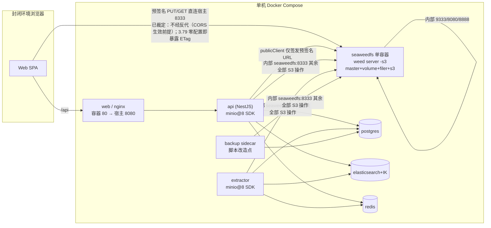
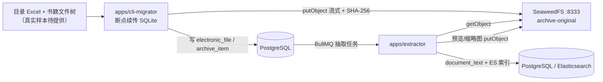

# 架构规格 —— SeaweedFS 方案 A（MinIO 替代）与封闭环境离线交付

> 版本 v1.1（实测更正 + 已裁定项补录）｜ 架构师：高见远 ｜ 基线：`E:\TianjiArchive` HEAD=`f111a7c`（`git rev-parse` 实测）｜ 状态：待评审
> 变更记录：v1.0 初稿；v1.1 按主理人实测证据更正 §3.4 volume 预分配口径（保留原 wiki 误判与更正过程），§1.2 补录双端点已裁定方案。
> 范围：**仅新增本文件**，不改代码、不改 `docs/ARCHITECTURE.md`（主架构文档仍以 MinIO 表述为准，待方案 A 验收后由主理人决定合并）。
> 目标：样品 demo 送封闭环境试用；8 项高敏参数走试用态默认值；真实书籍样本后续提供，试用阶段用模拟数据。
> 行文口径：【事实】= 有本地文件行号或官方 wiki 出处；【假设】= 未实测的推断；【建议】= 架构侧落地建议，非既成事实。

---

## 0. 证据基线（为什么换）

| # | 事实 | 出处 |
|---|---|---|
| E1 | MinIO 开源版 Server/Client/KES 归档停服：Docker Hub `minio/minio`、`minio/mc` 仓库级消失；`dl.min.io` 返回 HTTP 410 Gone | `docs/DEV-PROCESS.md:176-188`；`docker-compose.nominio.override.yml:4-14` |
| E2 | `infra/backup/Dockerfile:9` 从 `dl.min.io` 下载 `mc` → 全量 build 阻断；备份脚本仍依赖 `mc alias/mirror/rm/cp` | `infra/backup/Dockerfile:7-11`；`infra/backup/backup.sh:34-36,65-80`；`docs/DEV-PROCESS.md:186` |
| E3 | 联调临时覆盖 `docker-compose.nominio.override.yml` 用 profiles 禁用 minio/minio-init 并摘除 api/extractor/backup 的 depends_on；`/api/health` 因此 degraded | `docker-compose.nominio.override.yml:26-52`；`docs/DEV-PROCESS.md:186,199,203` |
| E4 | 主 compose 中四处依赖：`minio` 服务、`minio-init`、`api/extractor/backup` 的 `depends_on: minio` + `x-infra-env` | `docker-compose.yml:19-34,111-163,198-199,247-248,295-296,299-304` |
| E5 | 应用侧固定使用 `minio` JS SDK：pathStyle、region `us-east-1`、端口/凭据/桶名全部来自 `MINIO_*` 环境变量 | `apps/api/src/infra/storage/storage.module.ts:32-49`；`apps/api/src/config/configuration.ts:107-119` |
| E6 | 主理人实测 `chrislusf/seaweedfs:3.79` 可拉取，digest 前缀 `sha256:21425305…`（**完整 digest 需交付时回填**） | 主理人任务说明（非仓库文件） |
| E7 | 官方 wiki：`weed server -s3` 在单进程内启动 master + volume + filer + S3 gateway；S3 网关是无状态桥接到 Filer | https://github.com/seaweedfs/seaweedfs/wiki/Amazon-S3-API §How It Works |
| E8 | 官方 wiki：AWS S3 的 CreateBucket/HeadBucket/PutObject/GetObject/HeadObject/CopyObject/DeleteObject/ListObjectsV2、全部 multipart 操作、Presigned URLs 均标为支持 | https://github.com/seaweedfs/seaweedfs/wiki/Amazon-S3-API §Supported APIs / §Multipart Upload Operations / §Feature Differences |
| E9 | 官方 wiki：`-s3.config` 的 `identities[].credentials[].accessKey/secretKey`、`actions`；`Admin` 才能建/删桶；无凭据时为 Allow-All 模式 | https://github.com/seaweedfs/seaweedfs/wiki/S3-Credentials §Actions / §Anonymous Access；https://github.com/seaweedfs/seaweedfs/wiki/S3-Configuration §Available Actions |
| E10 | 官方 wiki：S3 端口 8333、filer 8888、master 9333、volume 8080；每桶一个 collection，默认 7 个 volume、每个 30GB，可能撑爆小盘（**其中"30GB/volume"已被 E11 在本镜像上证伪，见 §3.4；其余结论保留**） | https://github.com/seaweedfs/seaweedfs/wiki/Docker-Compose-for-S3；https://github.com/seaweedfs/seaweedfs/wiki/Getting-Started §Cheat Sheet；https://github.com/seaweedfs/seaweedfs/wiki/S3-API-FAQ §no free volumes left |
| E11 | 主理人在 `chrislusf/seaweedfs:3.79` 镜像内实测：entrypoint 的 `server` 分支自带 `-dir=/data -volume.max=0 -master.volumePreallocate -master.volumeSizeLimitMB=1024`，即 **1GB/volume**（非 wiki 的 30GB）；每桶约 7×1GB、四桶上限约 28GB | 命令 `docker run --rm --entrypoint sh chrislusf/seaweedfs:3.79 -c "sed -n '30,90p' /entrypoint.sh"`（主理人实测回传，非仓库文件） |

> **版本风险【假设】**：上述 wiki 页面编辑时间晚于 3.79 发布节奏，页面描述的 flag / action 集合可能包含 3.79 之后的能力。**所有 wiki 结论在 3.79 上须以容器内 `weed server -h`、`weed server -s3 -h` 实测复核**，不得直接照抄。E8 的"支持"是官方声明，不等于本项目 `minio@8` SDK 调用序列已验证。

---

## 1. 方案 A 单机拓扑与端口矩阵

### 1.1 进程形态【事实 + 建议】



- **【事实】** `weed server -s3` 一个进程同时承担 master、volume server、filer、S3 gateway；S3 网关只是把 S3 API 桥接到 filer（E7）。`weed server -dir="./data" -filer -s3` 是官方单机命令（Getting Started §Cheat Sheet）。
- **【事实】** 每桶映射到 filer `/buckets/<bucket_name>`，且每桶独占一个 collection（E7、E10）。
- **【建议】** Compose 中只保留一个 `seaweedfs` 服务（替换 `minio` + `minio-init` 两个服务，`docker-compose.yml:111-163`）；`api`/`extractor`/`backup` 的 `depends_on.minio` 改为依赖新服务 healthy（`:198-199,247-248,295-296`）。`docker-compose.nominio.override.yml` 因按服务名 `minio` 禁用，方案 A 落地后**必须作废**，否则会把新对象存储一起禁用（E3）。
- **【建议】** 健康检查不要用现成的 `mc ready local`（`docker-compose.yml:128`），改用 `curl -fsS http://127.0.0.1:9333/cluster/status?pretty=y`（Getting Started 用该路径验证 leader）。

### 1.2 端口矩阵【事实】

| 端口 | 组件 | 证据 | 与现有栈的边界 |
|---|---|---|---|
| 8333 | SeaweedFS S3 gateway | Docker-Compose-for-S3 暴露 `8333:8333`；S3-API-FAQ `$S3_ENDPOINT=http://localhost:8333` | **必须替换** `MINIO_PORT=9000`（`docker-compose.yml:23`、`apps/api/src/config/configuration.ts:109`、`.env.example:36`）；`MINIO_ENDPOINT` 改指向 SeaweedFS 服务名（`:22,108`） |
| 9333 | master HTTP | Getting Started `weed server -master.port=9333`、`curl :9333/cluster/status` | 容器内自检用；宿主可不发布 |
| 19333 | master gRPC（端口 +10000） | Getting Started §Set up Weed Volume Server | 容器网络内；宿主不发布 |
| 8888 | filer | S3-Credentials `weed s3 -filer=localhost:8888` | 容器内部；宿主不发布 |
| 8080 | volume server HTTP（默认） | Getting Started `weed server -master.port=9333 -volume.port=8080` | **冲突点**：现有 web 宿主端口 `${WEB_PORT:-8080}:80`（`docker-compose.yml:275`、`.env.example:93`），nginx 容器内监听 80（`apps/web/nginx.conf:3`）。**不得把 SeaweedFS 8080 发布为宿主 8080**；建议容器内保留 8080 但不映射到宿主，或显式改 `-volume.port=8081`【建议】 |
| 18080 | volume gRPC | Getting Started docker run `-p 18080:18080` | 容器内部；宿主不发布 |
| 9001 | 原 MinIO Console | `docker-compose.yml:126`、`.env.example:40` | 方案 A 无对应组件，端口应移除（SeaweedFS Admin UI 默认 12535，本次不启用） |

- **【假设·高风险｜已由实测项承接】** 预签名 URL 的 host 由 SDK `endPoint` 决定（`apps/api/src/infra/storage/storage.module.ts:35`、配置 `configuration.ts:108`），当前值为容器 DNS `minio`。浏览器直传（`apps/web/src/components/FileUploader.tsx:104,114`）要求该 host 对浏览器可达。若继续使用容器名，浏览器无法解析；若改用宿主 IP/域名，又与 SigV4 签名校验相关（S3 API FAQ §S3 authentication fails when using reverse proxy 要求 `X-Forwarded-Host/Proto/Port`，S3 Configuration 支持 `-s3.externalUrl`）。**这条链路是本方案最高优先实测项**，且属于既有的 MinIO 部署也存在的问题，不是 SeaweedFS 独有。→ **该假设不再作为未决项**：主理人已裁定双端点方案（下条），由工程师自验承接（见 R-1～R-10）。
- **【已裁定｜双端点】** 主理人正式裁定：新增 `S3_PUBLIC_ENDPOINT` / `S3_PUBLIC_PORT` / `S3_PUBLIC_USE_SSL` 三个配置；`MinioService` 使用**独立 `publicClient`** 且**仅**用于生成预签名 URL（`presignedUrl` / `presignedGetObject`，`storage.module.ts:102-121,263-281`），其余所有 S3 操作（bucketExists/makeBucket/putObject/getObject/statObject/multipart 合并/删除/列举等）继续走内部 `seaweedfs:8333`；浏览器**直连宿主 8333**、**不经 nginx 反代**。效果：把 SigV4 签名 host 与容器内部 DNS 解耦，从结构上绕开反代转发头导致 `SignatureDoesNotMatch` 的整类问题（S3 API FAQ §S3 authentication fails when using reverse proxy）；`/api` 仍走 nginx（`apps/web/nginx.conf:34-49`），两条路径互不干扰。
  - **【原假设 → 已实测更正，2026-11-09｜保留更正过程】** 原文写「双端点不消除跨域问题：浏览器对 8333 的 PUT/GET 仍需 CORS，且分片合并依赖 `ExposeHeaders: ["ETag"]`（§4 #9，S3-CORS §Set CORS Configuration）；`S3_PUBLIC_*` 取值须为封闭环境内浏览器可达的宿主机名/IP，且须与 SigV4 实际请求的 Host 一致」，据此一度把 CORS 列为**头号阻断项**并要求工程师配置 `PutBucketCors` / 单列 `ExposeHeaders: ETag`。架构师以 6 组容器内闭环实测（`chrislusf/seaweedfs:3.79`，镜像 `21425305e04b`，`weed version 30GB 3.79 228946369`；镜像无 curl/openssl，改用 busybox `nc` 构造原始 HTTP；上一轮宿主 curl 的 `Empty reply` 已定位为 Docker Desktop 代理的宿主网络层问题、非 S3 未就绪）更正如下：
    - **【实测证实】** 3.79 S3 网关内置**全局 CORS middleware**：请求带 `Origin` 时响应无条件带 `Access-Control-Allow-Origin: *`、`Access-Control-Allow-Credentials: true`、`Access-Control-Expose-Headers: *`（**`*` 通配覆盖 `ETag`，不是 `ETag` 字面值**）；CreateBucket 200 → CreateMultipartUpload 200 → `PUT ?partNumber=1&uploadId=...` → 200 + `ETag`；OPTIONS 预检 200 + 全套头；**鉴权开启下无签名 OPTIONS 仍 200、403 错误响应也带全套头**（middleware 在鉴权之外包裹所有响应）。
    - **【实测证实·方案假设被证伪】** `PUT /{bucket}?cors`（合法 CORSConfiguration XML 含 `<ExposeHeader>ETag</ExposeHeader>`）→ **501 NotImplemented**；`GET /{bucket}?cors` → 404 `NoSuchCORSConfiguration`；`s3.json` 静态写 `cors.allowed_origins` / `expose_headers` → 被忽略、响应头不变；`weed server -h`（14 个 `-s3.*` flag）与 `weed s3 -h` **均无** `exposeHeaders` / `allowedHeaders` / `cors.*` / `autoCreateBucket`；`-s3.allowedOrigins` 取具体值、非匹配 Origin、与 `-filer.allowedOrigins` 双置空三种情形响应头恒为 `*`。二进制 strings 中 `PutBucketCorsHandler` / `CORSConfiguration` / `ExposeHeaders` 符号只是 501 占位 —— **符号存在 ≠ 服务端能力**，据此推断「可用 bucket CORS 精确配置」作废。
    - **【实测证实】** CORS 头是**条件性的**：不带 `Origin` 的请求不返回任何 CORS 响应头。
    - **结论与唯一落法（零配置）**：CORS **不需要任何配置改造**；禁止 `PutBucketCors`、禁止 s3.json cors 段、禁止 nginx `add_header`，更不得为凑响应头把 `*` 改写成 `ETag`（3.79 配不出来）。「浏览器直连宿主 8333、不经反代」由架构选择升级为 **CORS 生效的前提** —— 若把 8333 收敛到与 Web 同域，浏览器不带 `Origin`，CORS 头消失、`ETag` 读不到。前端须保持 `axios.put` 默认 `withCredentials=false`（显式 `credentials: include` 会让 `Allow-Origin: *` + `Allow-Credentials: true` 被浏览器拒绝，且 `Expose-Headers: *` 被当字面量）；`FileUploader.tsx:108` 的 `res.headers.etag` 无需改动。
    - **仍需交付栈证据**：架构师实测是独立容器的「能力证据」，不是本系统证据。工程师须在交付栈用真实预签名 partUrl 打一次 PUT，留 `HTTP 200 + ETag + Expose-Headers: * + Allow-Origin: *` 响应头原值日志；该项同时补上【不确定】「带合法 SigV4 签名的预签名 PUT 在鉴权开启下的 200 响应」（镜像无 openssl 未直接实测，强证据链为「403 也带全套头 + 匿名 UploadPart 带 ETag」），并纳入 QA 阶段二 C08 现场验收。两类证据分开留、不合并。
    - **【主理人裁定·已知边界】** `Allow-Origin: *` / `Expose-Headers: *` 在 3.79 **无法收紧**，会向浏览器暴露 `X-Amz-Request-Id`、`Server` 等全部响应头。样品 demo 封闭内网阶段接受并如实登记；正式启用前若单位要求收紧，只有三条替代路径：①前置反代改写响应头（与直连冲突，且同域后无 Origin 连 `*` 也消失）；②服务端 `listParts` / HEAD 回传 part ETag（改契约、每分片多一次往返）；③分片走 API 代理（2GB 全量过 API，性能不可接受）。三条代价都高且与直连裁定冲突，**本轮不启用，须重新裁定架构**。
    - **【判据缺陷已发现】** QA 阶段一 `C08` 原按 `/(^|,)\s*etag\s*(,|$)/i` 字面断言暴露头，遇到 `*` 会**必然假红**并误归因为 `INCOMPATIBLE`；已要求 QA 改为接受 `*` 或显式 `etag`，并附 `credentials=omit` 静态守卫。验收验的是「浏览器能否读到 ETag」这一**效果**，不是响应头字面值。
  - **【建议】** `publicClient` 与内部 client 共用同一 `accessKey/secretKey/region/pathStyle`（`storage.module.ts:37-42`），只覆盖 `endPoint/port/useSSL`，避免两份凭据配置漂移。
- **【事实】** `/api/health` 通过 `MinioService.ping()`（→ `bucketExists`）检查对象存储（`apps/api/src/modules/health/health.module.ts:42-44`），字段名仍为 `minio`；方案 A 下该检查会落到 HeadBucket，需确认展示名是否改名（属工程师改造范围）。

### 1.3 数据卷与 NAS 挂载点【事实 + 建议】

- **【事实】** 主 compose 用宿主机目录 bind mount（`./volumes/<service>:/...`），不是 named volume（`docs/DEPLOY.md:29-43`）；MinIO 为 `./volumes/minio:/data`（`docker-compose.yml:122-123`），备份产物在 `./volumes/backup:/backup`（`:308-309`）。
- **【建议】** SeaweedFS 用 `./volumes/seaweedfs:/data` 并在 `weed server -dir=/data` 中显式指定（Getting Started §In production 示例 `-v /opt/weedfs/data:/data ... server -dir="/data"`）。`/data` 同时承载 master 元数据、volume 数据文件与 filer store（默认 filer store 类型**【假设】**，须用 `weed scaffold -config=filer` 或 `weed server -h` 在 3.79 上确认）。
- **【事实】** 官方镜像默认以非 root `seaweed` 用户运行，bind mount 目录需可写 UID/GID `1000:1000`（Getting Started §In production）。这与 ES 目录需 uid 1000 的既有约束一致（`docs/DEPLOY.md:52-57`）。
- **【事实·v1.1 更正】** `/data` 的 volume 预分配口径以镜像内实测为准：1GB/volume、四桶约 28GB，**不是** v1.0 按 wiki 推断的 840GB；完整更正过程见 §3.4。
- **【建议】** NAS 挂载点沿用 `volumes/` 单一父目录便于整目录拷贝；但 `/data`（对象数据）与 `volumes/backup`（备份）应落**不同物理盘**，否则不满足异盘备份语义（`docs/ARCHITECTURE.md:769`）。

---

## 2. S3 认证模型

### 2.1 `s3.json` 与现有环境变量的对应【事实】

官方格式（S3-Credentials §Configuration File / S3-Configuration §Configuration Format）：

```json
{
  "identities": [
    {
      "name": "tianji_app",
      "credentials": [
        { "accessKey": "<from MINIO_ACCESS_KEY>", "secretKey": "<from MINIO_SECRET_KEY>" }
      ],
      "actions": ["Admin", "Read", "Write", "List", "Tagging"]
    }
  ]
}
```

| 现有变量 | 证据 | SeaweedFS 落点 | 消费方 |
|---|---|---|---|
| `MINIO_ACCESS_KEY` | `docker-compose.yml:25`；`.env.example:41`；`configuration.ts:111` | `identities[].credentials[].accessKey` | api `storage.module.ts:38`、extractor `object.fetcher.ts:19`、backup `backup.sh:19`、cli-migrator `cli.ts:133` |
| `MINIO_SECRET_KEY` | `docker-compose.yml:26`；`.env.example:42`；`configuration.ts:112` | `identities[].credentials[].secretKey` | 同上（`storage.module.ts:39`、`object.fetcher.ts:20`、`backup.sh:20`、`cli.ts:134`） |
| 桶名 4 项 | `docker-compose.yml:27-30`；`configuration.ts:113-118` | 与 actions 中的桶级授权保持一致（`Read:<bucket>` 等，wiki 支持 `Action:Bucket` 形式） | `storage.module.ts:43-48` |

- **【事实】** `Admin` = 全权限、可建/删桶（S3-Configuration §Available Actions）。应用启动会 `makeBucket`（`storage.module.ts:60-69`），因此需要 `Admin`；若最终把建桶责任完全交给 init sidecar，可改用桶级 `Admin:<bucket>` 收敛权限（S3-Credentials §Bucket-Specific Actions）。
- **【事实·安全红线】** 未配置任何 identity 时 S3 网关进入 **Allow-All 模式**，所有操作无需认证（S3-Credentials §Anonymous Access）。因此 demo 环境**也必须注入 identity**，不能"图省事不配凭据"。
- **【事实】** 认证方式优先级：配置文件（`-config`/`-s3.config`）> filer 配置 > Admin UI > 环境变量，且高优先级完全覆盖低优先级不合并（S3-Credentials §Priority System）。故若用 s3.json，就不要再依赖环境变量里的 AWS_* 凭据。
- **【事实】** 官方 compose 示例通过 entrypoint 在容器启动时由 shell 生成 JSON（Docker-Compose-for-S3）；`weed server -s3 -s3.config /etc/seaweedfs/config.json` 为受支持写法（S3-Configuration §Basic Credentials）。

### 2.2 凭据注入与轮换边界【建议 + 事实】

1. **注入**：真实凭据只放未入库的 `.env`（`.gitignore:11-15` 明确 `.env` 不入库、`.env.example` 必须入库为模板）；`.env.example:41-42` 的 `tianji_minio` / `tianji_minio_change_me` 是占位默认值，**不得写入交付物**。s3.json 由部署脚本/entrypoint 从环境变量在容器内生成，绝不落盘到仓库、绝不写进镜像层【建议】。
2. **轮换**：静态配置文件不自动重载，需 `SIGHUP` 或重启；环境变量方式不自动重载且优先级最低，变更必须重启（S3-Credentials §Configuration Reloading）。轮换动作 = 改 `.env` → 重新生成 s3.json → 重启/SIGHUP SeaweedFS → 同步更新 api/extractor/backup/cli-migrator 的凭据并 **重建容器**（`docs/DEPLOY.md:378,486` 明确 `restart` 不重读 `.env`，须 `up -d`）【事实+建议】。
3. **轮换边界【假设】**：轮换会使旧密钥签发的未过期预签名 URL 失效（`storage.module.ts:49` 默认 3600s 有效期，`file.service.ts:329,364,376,418` 预览/下载 300~900s）。需在维护窗口执行并提示在途上传任务重试；是否即时失效须实测。
4. **【建议】** 生产按最小权限拆分：应用用一个 RW identity；备份任务单独 identity 且对 `archive-backup` 限定桶级写权限；禁止所有身份共享同一密钥。

---

## 3. 桶策略与四性检测

### 3.1 四桶清单【事实】

| 桶 | 默认名 | 写入方 | 证据 |
|---|---|---|---|
| original | `archive-original` | 前端预签名直传、cli-migrator | `docker-compose.yml:27`；`file.service.ts:150-151`；`apps/cli-migrator/src/migrator.ts:141` |
| preview | `archive-preview` | extractor 转换产物 | `docker-compose.yml:28`；`apps/extractor/src/object.fetcher.ts:31-34` |
| thumb | `archive-thumb` | extractor 缩略图 | `docker-compose.yml:29`；`object.fetcher.ts:36-39` |
| backup | `archive-backup` | backup sidecar / BackupService | `docker-compose.yml:30`；`infra/backup/backup.sh:66-80`；`apps/api/src/modules/backup/backup.service.ts:316-319` |

### 3.2 创建责任【事实 + 建议】

现状存在**三条**建桶路径，必须收敛为一条【建议】：

1. compose `minio-init`：`mc mb --ignore-existing` 建四桶（`docker-compose.yml:146-151`）；
2. 应用启动：`MinioService.onModuleInit → ensureBuckets → bucketExists/makeBucket`（`storage.module.ts:52-69`），且失败仅 warn 降级（`docker-compose.nominio.override.yml:19-20` 已说明）；
3. SeaweedFS 默认 `-s3.autoCreateBucket=true`，上传时自动建桶（S3-Configuration §Automatic Bucket Creation）。

- **【建议】** 方案 A 保留 init sidecar 为**唯一**建桶责任方（保留现有幂等语义），同时显式设 `-s3.autoCreateBucket=false` 关闭隐式建桶；应用的 `ensureBuckets` 降级为只读检查/告警。理由：自动建桶会让"拼错桶名"静默产生新桶与新的 collection（E10 中"每桶一个 collection"仍成立），且绕过了审计。
- **【事实·v1.1 更正】** 本节涉及的"新 collection 会撑爆小盘"推断已按 E11 更正：镜像已内置 1GB/volume，四桶上限约 28GB，详见 §3.4；**收敛建桶责任的理由不变**（避免静默建桶/绕过审计），但不再以"840GB 预分配"为依据。
- **【事实】** `mc` 已不可用（E1/E2），`minio-init` 的 `mc mb`/`mc ilm` 与 `mc anonymous set none` 语法全部不可复用；替代方案须用 S3 API（`CreateBucket` / `PutBucketLifecycleConfiguration`）或 `weed shell` 命令，由工程师实现。
- **【事实】** 现有契约测试只校验桶名常量与方法存在、不发起网络请求（`apps/api/__tests__/storage.minio-contract.spec.ts:4-8,70-78,97-124`），**不能作为四桶已创建的证据**。

### 3.3 生命周期【事实 + 建议】

- **【事实】** 当前 `minio-init` 对 `archive-original` 的 `tmp/` 前缀设 1 天过期（`docker-compose.yml:152`）。SeaweedFS 支持 `Get/Put/DeleteBucketLifecycleConfiguration`，但 **Transition 规则不支持**（E8 §Bucket Configuration）；TTL 亦可用 `PutBucketLifecycleConfiguration` 的 Expiration 或 `weed shell fs.configure -ttl` 实现（S3-API-FAQ §Setting TTL）。
- **【事实】** 备份保留由 `BACKUP_RETENTION_DAYS`（`docker-compose.yml:306`、`.env.example:86`）与 `backup.sh:31-37` 的本地清理 + `mc rm --older-than` 共同实现；参数侧已有 `backup.keep_copies`（`packages/shared/src/params.ts:369`）。方案 A 下 `mc rm` 必须替换。
- **【建议】** 生命周期分层：original 永久保存（合规原件，禁止自动过期）；preview/thumb 为可再生派生物，允许更长周期的 TTL 或按需清理；backup 按 `backup.keep_copies` 保留；`tmp/` 前缀 1 天规则迁移到 S3 Lifecycle 后需实测生效（wiki 未说明 Expiration 执行周期）。
- **【事实·容量风险｜v1.1 已更正】** v1.0 按官方 wiki 推断"每桶 7×30GB、四桶≈840GB 预分配，100GB 导入会触发 No free volumes left"（E10 / S3-API-FAQ）。该推断**已被 E11 镜像实测证伪**：本镜像自带 1GB/volume，四桶上限约 28GB，**无需因 840GB 预设调优**；完整证据与更正过程见 §3.4。仍待工程师起栈实测的是 `-master.volumePreallocate` 的实际磁盘占用（稀疏文件还是真实预分配）与 `-volume.max=0` 在 3.79 上的确切语义【假设】。

### 3.4 【实测更正】volume 预分配口径（v1.1，保留误判与更正过程）

> 团队方法学要求：**不抹掉原推断，显式记录"推断 → 证伪 → 更正"的链条**，便于后来人理解为何文档里两套数字并存。

**① 原推断（v1.0，已被证伪，保留留痕）**
依据官方 wiki「每桶一个 collection，通常 7 个 volume，每 volume 默认 30GB」（E10；Amazon S3 API §Support Many Buckets、S3-API-FAQ §no free volumes left），v1.0 在 §3.3 与 §6.2 推出：四桶 ≈ 4×7×30GB = **840GB** 预分配，demo 小盘会在 100GB 导入中途 `No free volumes left`，因此必须手工调 `-volumeSizeLimitMB=1024`。该推断的问题在于**把"上游 `weed` 二进制默认值"当成了"本 Docker 镜像的实际启动参数"**——镜像 entrypoint 会覆盖默认值。

**② 实测证据（主理人执行，非仓库文件）**

```bash
docker run --rm --entrypoint sh chrislusf/seaweedfs:3.79 -c "sed -n '30,90p' /entrypoint.sh"
```

输出要点：`server` 分支的启动命令自带

```
-dir=/data -volume.max=0 -master.volumePreallocate -master.volumeSizeLimitMB=1024
```

即**每 volume 上限 1GB（1024MB），不是 30GB**。据此：
- 每桶约 7×1GB ≈ **7GB**；四桶上限约 **28GB**；
- `840GB` 不成立，"100GB 导入会因 840GB 预分配而撑爆"这一因果链不成立；
- 镜像已内置 v1.0 建议手工调的 `-master.volumeSizeLimitMB=1024`，无需再在 compose 里重复设置（重复设置的 flag 名/优先级仍按 §7 第 1 条实测）。

**③ 更正后的结论（本文件当前口径）**

| 项 | v1.0 推断 | v1.1 实测更正 |
|---|---|---|
| volume 大小上限 | 30GB | **1GB**（`-master.volumeSizeLimitMB=1024`） |
| 四桶预分配上限 | ≈840GB | **≈28GB** |
| demo 是否必须预调优 | 必须 | **不必因 840GB 调优**；镜像已内置 |
| 100GB 真实样本风险 | "导入中途 No free volumes left" | 改为：按 1GB/volume 增长需约 100+ 个 volume，须复核 `-volume.max=0` 语义与磁盘真实余量，**不再按 840GB 估算** |

**④ 仍未闭环（【假设】，交工程师起栈实测）**
1. `-master.volumePreallocate` 的实际磁盘占用：是稀疏文件（逻辑 1GB、实际按写入增长）还是真实占满 1GB/volume —— 这决定 28GB 是"上限"还是"立即占用"；
2. `-volume.max=0` 在 3.79 的语义（是否表示不限 volume 数量）【假设】，wiki 未给出；
3. 100GB 真实样本导入时 volume 增长数量与 `-volume.max` 的关系，需一次 1~5GB 连续导入预演（§6.2）。

> 其余 wiki 结论（每桶一个 collection、`fs.configure -volumeGrowthCount=1` 可调增长、"No free volumes left" 故障形态本身）**未被证伪，继续保留**（E10）。

### 3.5 与四性检测 SHA-256 的关系【事实】

- 完整性基线是**服务端对完整对象重算 SHA-256**：`storage.module.ts:176-190`（`getObject` 流逐块哈希）、`file.service.ts:214-227`（与客户端 `dto.sha256` 比对，不一致即删脏对象并抛 `FILE_HASH_MISMATCH`）、落库字段 `electronic-file.entity.ts:12,37`（`idx_file_sha`）、迁移工具同口径 `apps/cli-migrator/src/migrator.ts:137-158`。
- 对象存储只提供字节流与元数据；**ETag 不是完整性基线**。【原假设 → 部分实测更正】原文写「SeaweedFS 3.79 的 ETag 语义（是否 MD5、multipart 合并后形式）在现有证据中未给出【假设】，必须实测」。架构师以 4 组独立样本（hello / abc / world / xyz）实测：**单对象 PUT 与 UploadPart 的 ETag = 请求体内容 MD5【实测证实】**；**multipart 合并后的 ETag 形式仍未实测**（本轮未执行 CompleteMultipartUpload），保留为待实测子项（§7 第 2 条）。但无论结果如何，**校验逻辑不应改为信任 ETag** —— 该结论不受影响，原句保留。
- `statObject` 只用于大小/存在性（`storage.module.ts:193-209`，`file.service.ts:209-212`），与四性中的真实性/可用性/安全性接口无关。

---

## 4. 兼容性边界清单（minio@8 SDK → SeaweedFS S3 Gateway）

> wiki 声明"支持"（E8）只说明 API 存在；**本项目 SDK 调用序列、签名参数与浏览器 CORS 链路必须逐项实测**。验证统一使用固定 digest 的 3.79 容器 + `minio@8`（`apps/api/package.json` 依赖）+ 现有 `storage.module.ts` 方法，禁止只用 mock。

| # | 本地调用（文件:行） | S3 wire 操作 | wiki 支持 | 风险 / 已知差异 | 验证方法 | 必须实测 |
|---|---|---|---|---|---|---|
| 1 | `bucketExists` `storage.module.ts:63,73` | HeadBucket | Yes（E8） | 无凭据时 Allow-All 会掩盖鉴权问题（E9） | 有/无 identity 各跑一次；`ping()` 返回 true/false 符合预期 | ✔ |
| 2 | `makeBucket` `storage.module.ts:65` | CreateBucket | Yes（E8） | 需 `Admin`（E9）；与 `autoCreateBucket` 默认 true 叠加会重复建桶 | 以受限 identity 调用应 403；重复调用幂等 | ✔ |
| 3 | `putObject` `storage.module.ts:233-241,244-260`；extractor `object.fetcher.ts:48-50` | PutObject | Yes（E8） | `Content-Type`/自定义 meta（`x-amz-meta-*`）在 SeaweedFS 的回显与 HeadObject 一致性未验证【假设】 | 写小对象 + 带 meta 写预览对象，GET/HEAD 回读逐字段比对 | ✔ |
| 4 | `getObject` `storage.module.ts:178,217,222`；`object.fetcher.ts:27` | GetObject（含 Range） | Yes（E8，Range 支持） | 预览走 Range 流式（`apps/web/nginx.conf:44-48`）；大文件 2GB 流式读取内存边界 | 小文件全量 + `Range: bytes=0-1023` + 50MB 文件 SHA-256 重算比对 | ✔ |
| 5 | `statObject` `storage.module.ts:194` | HeadObject | Yes（E8） | `metaData` 字段名大小写/前缀归一化差异【假设】 | meta 回读一致性用例（同 #3） | ✔ |
| 6 | `presignedUrl('PUT')` `storage.module.ts:102-121`；`presignedGetObject` `storage.module.ts:263-281` | Presigned URL（SigV4） | Yes（E8 §Feature Differences） | **①** `uploadId`/`partNumber` 作为 reqParams 进入签名（`:98-100,113`），SeaweedFS 是否接受该查询串的 SigV4 规范化未验证；**②** 预签名 host 由 `S3_PUBLIC_*` + 独立 `publicClient` 提供，浏览器直连宿主 8333、不经反代（§1.2 **已裁定**，原高风险假设已由工程师自验承接）；**③** 若将来改回反代才需要 `X-Forwarded-*` 或 `-s3.externalUrl`（S3 API FAQ / S3 Configuration），当前方案不适用 | 生成 URL 后用浏览器同源/跨域 PUT；分别测整对象 PUT（含 `Content-Type` 签名）与分片 PUT；测 300/900/3600s 过期；核对 URL Host 与 `S3_PUBLIC_ENDPOINT` 一致 | ✔ **最高优先** |
| 7 | `initiateNewMultipartUpload` `storage.module.ts:89-93` | CreateMultipartUpload | Yes（E8） | 桶级权限：wiki 注明 multipart 操作在授予 `s3:PutObject` 时隐式放行；3.79 是否一致【假设】 | 3 分片（5MB×2 + 尾片）全流程；记录返回的 uploadId | ✔ |
| 8 | `listParts` `storage.module.ts:130-146` | ListParts | Yes（E8） | **本地实现风险**：代码把 SDK 的 `protected listParts` 用 `as unknown as` 窄化调用（`:135-142`），这是 minio@8 内部 API，与网关无关但版本敏感；现网流程并不调用它（分片 ETag 由浏览器回传，`FileUploader.tsx:108-109` → `file.service.ts:199-206`） | 独立调用 `listParts` 校验返回结构 `{part, etag, size}`；另跑契约测试确认方法存在（`storage.minio-contract.spec.ts:105-123`） | ✔ |
| 9 | `completeMultipartUpload` `storage.module.ts:149-161` | CompleteMultipartUpload | Yes（E8） | **最关键**：浏览器从 `res.headers.etag` 取 ETag 去引号后回传（`FileUploader.tsx:104-109`），若 SeaweedFS 返回的 part ETag 格式/大小写不同，合并会失败；且 CORS 必须 `ExposeHeaders: ["ETag"]` 否则浏览器读不到（S3-CORS §Set CORS Configuration） | 3 分片→合并→GET 全对象→SHA-256 与源文件比对；故意传错 ETag 应报错；浏览器端实测 CORS preflight + ETag 可读 | ✔ **最高优先** |
| 10 | `abortMultipartUpload` `storage.module.ts:164-170` | AbortMultipartUpload | Yes（E8） | 僵尸分片清理 | 上传 2 片后 abort，再 GET 应 404 | ✔ |
| 11 | `removeObject` `storage.module.ts:284-290` | DeleteObject | Yes（E8） | wiki 注明 DeleteObject 会删除文件夹、空目录异步清理，与 AWS S3 行为不同 | 哈希不符删脏对象路径（`file.service.ts:222,233`）实测 | ✔ |
| 12 | `copyObject` `storage.module.ts:292-305` | CopyObject | Yes（E8） | 备份/恢复链路可能使用；源路径写死 `/${sourceBucket}/${sourceKey}` 形式 | 跨桶 copy + stat | ✔ |
| 13 | `listObjectsV2` `storage.module.ts:307-327` | ListObjectsV2 | Yes（E8） | wiki 注明"不允许 `/` 之外的 delimiter"、"同一路径不能同时是文件和文件夹" | 备份清理与 prefix 列表用例 | ✔ |
| 14 | 桶生命周期（原 `mc ilm`，`docker-compose.yml:152`） | PutBucketLifecycleConfiguration | Yes，Transition 不支持（E8） | `mc` 不可用（E1/E2）；Expiration 执行周期未知【假设】 | 设 `tmp/` 1 天规则 → `GetBucketLifecycleConfiguration` 回读 → 时间加速/等待验证 | ✔ |

**统一验证脚本的最小用例集【建议】**（新增，不影响现有单测）：①四桶存在性与鉴权；②小文件 PUT/GET/HEAD + 自定义 meta；③整对象预签名 PUT；④分片预签名 PUT（≥3 片）+ ETag 回读 + 合并 + SHA-256 比对；⑤`listParts`/abort；⑥预签名 GET + Range；⑦CORS preflight + 响应头 `Access-Control-Expose-Headers: *`（3.79 实测值、零配置、须带 Origin；架构侧容器内已实测通过，QA 现场仍须用真实预签名 URL 复验，验的是「浏览器能否读到 ETag」效果而非字面值）；⑧2GB / 5MB 分片（410 片）边界；⑨`statObject` 大小与 `computeSha256` 一致；⑩错误凭据 403。
> **【事实】** 现有 `storage.minio-contract.spec.ts:4-8` 明确"不发起网络请求"，只能验证 SDK 方法存在，不能替代上述任何一条。

---

## 5. 封闭环境离线交付

### 5.1 镜像清单【事实 + 建议】

| 类别 | 镜像 | 证据 | 离线处置 |
|---|---|---|---|
| 基础镜像 | `postgres:16-alpine` | `docker-compose.yml:39` | 按 digest 固定，`docker save` 打包 |
| 基础镜像 | `redis:7-alpine` | `docker-compose.yml:167` | 同上 |
| 基础镜像 | `chrislusf/seaweedfs:3.79` | E6（主理人实测可拉取，digest 前缀 `sha256:21425305…`） | **回填完整 digest** 后打包 |
| 基础镜像 | `node:22-bookworm-slim`（api/web/extractor 的 deps+runtime） | `apps/api/Dockerfile:2,18`；`apps/web/Dockerfile:2`；`apps/extractor/Dockerfile:2,16` | 同上 |
| 基础镜像 | `nginx:1.25-alpine` | `apps/web/Dockerfile:16` | 同上 |
| 基础镜像 | `alpine:3.20` | `infra/backup/Dockerfile:5` | 同上 |
| 基础镜像 | `docker.elastic.co/elasticsearch/elasticsearch:8.13.4` | `infra/elasticsearch/Dockerfile:8` | 同上 |
| 产物镜像 | `tianji-elasticsearch-ik:8.13.4` | `docker-compose.yml:76-82` | 构建环境产出后打包，现场不 build |
| 产物镜像 | `tianji-archive-api:1.0.0` / `extractor:1.0.0` / `web:1.0.0` / `backup:1.0.0` | `docker-compose.yml:190,239,268,289` | 同上 |
| 离线文件 | `elasticsearch-analysis-ik-8.13.4.zip` | `infra/elasticsearch/Dockerfile:15-27`；`docs/DEPLOY.md:96-112`；`docs/DELIVERY-CHECKLIST.md:234` | 预置到 `infra/elasticsearch/ik/`，否则构建期联网 |
| 离线文件 | 备份侧 S3 客户端二进制 | `infra/backup/Dockerfile:9` 的 `mc` 来源已 410（E2） | **必须在构建环境预置替代二进制并烤进镜像**；`backup.sh` 的 `mc mirror/rm/cp` 调用点（`:34-36,65-80`）需同步改造，属工程师范围 |

### 5.2 信任边界【事实 + 建议】

- **【事实】** 当前 compose 有 5 处 `build:`（elasticsearch `:76-82`、api `:187-190`、extractor `:236-239`、web `:263-268`、backup `:286-289`），且 Dockerfile 内含联网动作：`pnpm install`（`apps/api/Dockerfile:8`）、`apt-get install`（`apps/api/Dockerfile:20-22`、`apps/extractor/Dockerfile:18-24`）、`apk add`（`infra/backup/Dockerfile:7-9`）、IK 插件下载（`infra/elasticsearch/Dockerfile:22-25`）。**封闭环境无公网、无现场 build、无外部下载** → 现场 compose 必须是 **build-free**（只保留 `image:` + digest），全部产物镜像在构建环境产出后用 `docker save`/`docker load` 迁移【建议，工程师并行改造】。
- **【建议】** 交付物为：镜像 tar 包 + 每包 SHA-256 清单 + digest 清单 + compose/`.env.example`/`s3.json` 生成脚本 + 离线 IK zip + 模拟数据种子。现场只执行 `docker load` / `docker compose up -d` / 迁移与 seed（`docs/DEV-PROCESS.md:200-201` 记录过 5/5 迁移 + seed 成功的既有流程）。
- **【建议】** 凭据不进任何镜像与入库文件：`.env` 单独介质交付并现场生成（`.gitignore:11-15`）；`s3.json` 运行时生成；日志/报告不输出密钥（`docs/DEV-PROCESS.md:172` 已有"凭证 helper 输出禁止进入日志"纪律）。
- **【建议】** 网络边界：SeaweedFS 9333/8888/8080/18080/19333 只在 `tianji-net` 内可达；8333 **按 §1.2 已裁定双端点方案须向宿主发布**（浏览器直连、不经反代），发布时限定来源 IP 或由现场网络策略控制；不得暴露 Allow-All 模式（E9）。

### 5.3 升级与回滚粒度【建议】

| 层级 | 变更内容 | 粒度 | 回滚 |
|---|---|---|---|
| L0 配置 | `.env`（端口/凭据/桶名）、`s3.json` 重新生成、`autoCreateBucket`/volumeSizeLimit 等 flag | 重建受影响容器（`docs/DEPLOY.md:378,486`：`restart` 不重读 `.env`，须 `up -d`） | 保留上一版 `.env` 与 s3.json 模板，重建即回滚 |
| L1 应用 | api / web / extractor / backup 单个镜像 digest | 单服务替换，其他服务不动 | 切回上一 digest |
| L2 对象存储 | SeaweedFS 镜像版本号 | 单容器重启，**`/data` 卷不动** | 切回旧 digest；跨大版本回滚前须验证卷格式兼容性【假设】 |
| L3 数据 | PG schema migration / seed | 全量备份后执行；无自动降级 | 由 `pg_dump` 备份恢复（`infra/backup/backup.sh:48-61`），对象桶按 L2 保留 |
| L4 凭据轮换 | 见 §2.2 | SeaweedFS + 四个消费方同时切换 | 需维护窗口；旧预签名 URL 失效【假设】 |

> **【建议】** 每个镜像以 digest 而非 tag 固定；升级前先对 `volumes/seaweedfs` 与 `volumes/postgres` 做快照（异地/异盘），这是 RPO/RTO 口径的基础（`docs/ARCHITECTURE.md:769`）。

---

## 6. demo → 生产演进路径

### 6.1 高敏参数试用态【事实】

`packages/shared/src/params.ts` 中 `confirm: 'HIGH'` 共 **8 项**（第 40-46 行定义级别），逐项取值如下：

| key | 默认 | 证据 | 生效模式 |
|---|---|---|---|
| `borrow.max_total_days` | 90 | `params.ts:134-146` | judgment |
| `borrow.max_renewal_count` | 1 | `params.ts:149-160` | judgment |
| `borrow.max_renewal_days` | 30 | `params.ts:163-175` | judgment |
| `preview.watermark_enabled` | true | `params.ts:224-233` | read-immediate |
| `preview.watermark_template` | `{username} {datetime}` | `params.ts:236-245` | read-immediate |
| `preview.download_mode` | `approval` | `params.ts:248-259` | read-immediate |
| `security.session_timeout_min` | 30 | `params.ts:280-292` | read-immediate |
| `log.retention_years` | 3 | `params.ts:383-390` | retention，`editable: false`（PR-P7） |

- **【事实】** 参数体系是 `PARAM_DEFS` 单一定义源（`params.ts:1-12,131`），改口径只需改参数值/定义，不改业务代码；`editable=false` 项管理端禁改（`:390`）。
- **【事实】** 这些默认值当前是**产品建议值、未经使用单位确认**（`docs/QA-REPORT.md:236` 亦记录 `MAX_TOTAL_DAYS=90 / MAX_RENEWAL_COUNT=1` 为产品默认值未经单位正式确认）。
- **【架构影响·建议】** ①demo 用模拟数据，不承担涉密数据，试用态默认值可接受；②正式上线前须由**保密部门 + 档案部门**逐项确认 8 项并出具确认值，尤其水印开关/模板、下载模式、会话超时、日志保留年限；③确认动作只更新 `sys_param`（或 `PARAM_DEFS` 默认值需同步 PRD/架构两份文档），**不改代码、不重发镜像**；④demo 凭据为占位默认值（`.env.example:41-42,62-63`），正式上线前必须全部轮换；⑤`log.retention_years` 为 `editable=false`，若单位要求更长年限需走代码/文档变更而非管理端配置。
- **【建议】** 在 demo 交付清单中显式标注"8 项参数为试用态默认值，不构成本单位制度口径"，避免试用报告被误读为已确认。

### 6.2 真实书籍样本（可能 100GB 级）接入的管线预留点【事实 + 建议】

现有链路（无需新增组件，只需换 endpoint/凭据并做容量规划）：



- **【事实】** 迁移工具用 minio SDK 直连：`apps/cli-migrator/src/cli.ts:129-150`（`MinioClient` + `MINIO_*` 环境变量）、`apps/cli-migrator/src/migrator.ts:137-158`（本地逐文件 SHA-256 → `putObject` → 写 `electronic_file`）、断点状态 SQLite `apps/cli-migrator/src/checkpoint.ts:45-56,113-175`、`--batch-max-rows` 承接 `import.batch_max_rows`（`cli.ts:51-59,161-169`）。
- **【事实】** 抽取侧 `apps/extractor/src/object.fetcher.ts:14-23` 直接 `new MinioClient`，并读 `MINIO_BUCKET_ORIGINAL`（`:22`）；因此**端点/端口/凭据改造必须覆盖 cli-migrator 与 extractor 两处独立客户端**，不能只改 api 的 `configuration.ts`。
- **【事实】** 上传链路另有浏览器分片直传：`file.service.ts:150-185`（5MB 分片，`packages/shared/src/enums.ts:572-574` 定义 `MAX_FILE_SIZE=2GB`、`CHUNK_SIZE=5MB`），`FileUploader.tsx:99-134`。
- **【建议·容量｜v1.1 已更正】** 原"每桶 7×30GB、四桶≈840GB 预分配会在 100GB 导入中途 No free volumes left"推断已被 E11 证伪（完整更正过程见 §3.4）：本镜像为 **1GB/volume、四桶约 28GB**，且已内置 `-master.volumeSizeLimitMB=1024`，**不再要求为 840GB 预设调优**。100GB 真实样本接入前仍需完成：①起栈实测 `-master.volumePreallocate` 的真实磁盘占用与 `-volume.max=0` 语义；②按 1GB/volume 估算约 100+ 个 volume 的增长与磁盘余量；③`docs/ARCHITECTURE.md` 在线 150GB + 备份区 1TB 的基线按实测值复核【假设】。
- **【建议·管线】** 100GB 导入走 cli-migrator 批量通道（断点续传 + 校验报告），不走浏览器分片；每批完成后校验 `electronic_file.sha256` 与源文件一致；抽取队列并发由 `EXTRACT_CONCURRENCY`（`docker-compose.yml:253`，默认 4）控制，避免同时压满 S3 与 LibreOffice/ffmpeg。
- **【建议·验证】** 真实样本到位前，用模拟数据跑通 §4 的 14 项兼容用例 + 一次 1~5GB 的连续导入，作为"100GB 接入"的预演门槛。

---

## 7. 待明确事项（不阻塞 demo，但须在正式上线前闭环）

1. **【部分已实测更正】** flag 名称与可用性：`weed server -h` 实测有 `-s3.allowedOrigins`（默认 `*`）、`-s3.config`、`-s3.port` 等 14 个 `-s3.*`；`weed s3 -h` 有 `-allowedOrigins`；**均无** `exposeHeaders` / `allowedHeaders` / `cors.*` / `autoCreateBucket`。工程师交叉验证一致，并据此改用 `s3.json` 桶级授权关闭自动建桶（不授全局 Admin，否则放行任意桶自动建桶）；`-master.volumeSizeLimitMB=1024` 由镜像内置 `/entrypoint.sh` 的 `server` 分支自带（E11），工程师改造后改为委派该分支以继承调优参数。**剩余待实测**：`-master.volumePreallocate` 实际占用语义与 `-volume.max=0`（第 8 条）。
2. **【已实测结案 → 拆条】** 原文「仍待实测 CORS `ExposeHeaders: ETag` 在 3.79 是否生效与分片 ETag 格式」：CORS 一项已由架构师 6 组容器内实测结案（3.79 零配置返回 `*` 通配，详见 §1.2 更正段），**不再列为待明确**；仅保留两项证据缺口：①交付栈用真实预签名 partUrl 打一次 PUT 断言 `HTTP 200 + ETag + Expose-Headers: *`（覆盖【不确定】「带合法 SigV4 签名的预签名 PUT 在鉴权开启下的 200 响应」），已纳入 QA 阶段二 C08；②**multipart 合并后的 ETag 形式**仍未实测，但完整性校验不依赖 ETag（§4 结论不变）。
3. **【待决策】** 备份 sidecar 用何种离线 S3 客户端替换 `mc`（镜像内烤入 / 改用 `weed` 命令 / 用 API 侧 `BackupService`）；`backup.sh:34-36,65-80` 与 `backup.service.ts:304` 的恢复说明需同步。
4. **【待决策】** 建桶责任单点归属（init sidecar vs 应用 `ensureBuckets`）与 `autoCreateBucket=false` 的取舍（§3.2）。
5. **【待确认】** 8 项高敏参数的单位确认值、demo 凭据轮换责任人与时间窗（§6.1）。
6. **【待确认】** 真实书籍样本的文件类型分布与总量，用于 volume 上限、分片数与抽取并发的最终取值。
7. **【待确认】** 主架构文档 `docs/ARCHITECTURE.md` 中 MinIO 表述（`:4,40,57,66,68,69,86,90,641,686,769,801,803,805,819`）何时合并为本方案；本文件不改主文档。
8. **【假设待实测｜v1.1 新增】** `-master.volumePreallocate` 的实际磁盘占用（稀疏 or 真实预分配）与 `-volume.max=0` 在 3.79 的语义；由工程师起栈实测回填 §3.4 ④。

---

*本文件只描述方案 A 的架构规格与验证边界；Compose 改造、SDK 兼容实测、备份脚本替换由工程师并行实施，demo 清单由 PM 并行产出。*
