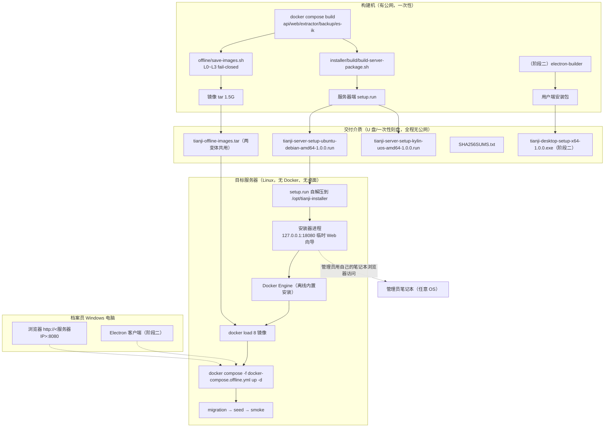
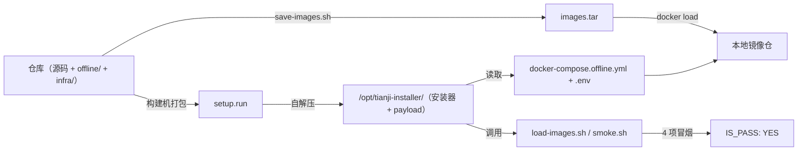
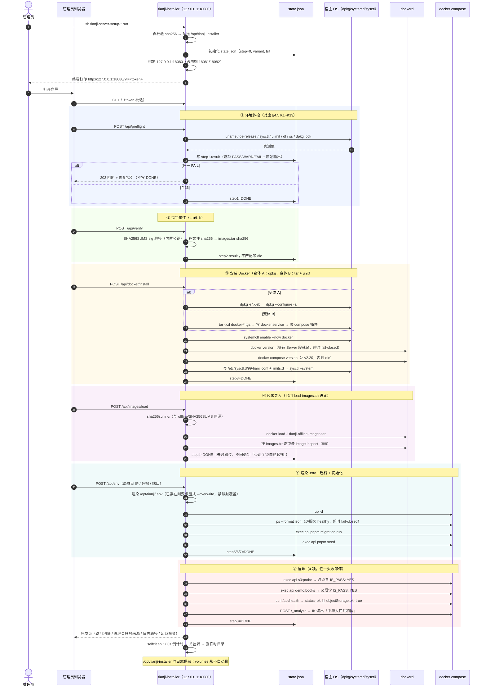
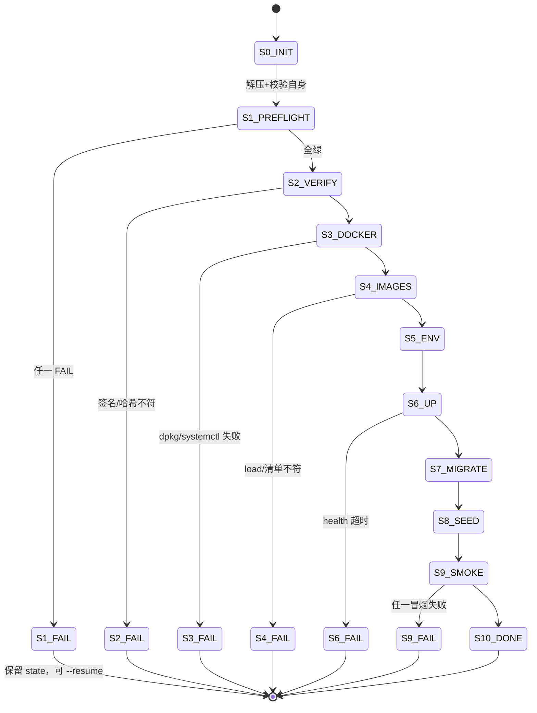

# 天玑档案管理系统 · 双安装包总体设计（服务器端 + 用户端）

| 项 | 值 |
|---|---|
| 文档编号 | INSTALLER-DESIGN v1.0 |
| 任务 | #40（双安装包立项） |
| 状态 | 设计稿 —— 含 8 项【待裁定】开放问题，重大分叉未自行拍板 |
| 适用仓库 | `E:\TianjiArchive` |
| 基线 HEAD | `7edbec5` |
| 落盘范围 | 仅本文件。不改动 `offline/`、`docs/` 其他文档、源码 |

## 0. 文档定位与标注约定

本文回答的是「**怎么把现在这套只能手工部署的离线包，变成两个可交付的一键安装包**」，不重复 `docs/ARCHITECTURE.md`（系统架构）与 `docs/ARCHITECTURE-SEAWEEDFS.md`（对象存储方案）已定内容。

全文结论分三类标注，沿用本项目纪律：

- **【事实】** 已在本仓库文件中读到，附 `路径:行号`；
- **【估算】** 依现有产物尺寸推算，未实测，交付前必须复核；
- **【待裁定】** 需主理人/用户拍板，本文**不给结论**，只列候选与代价。

同时沿用团队方法学：**fail-closed、证据留痕、每步可校验、失败即停不静默降级**。现有 `offline/save-images.sh:26-30` 已把这条纪律固化成 L0~L3 四层闸门，安装器设计必须同等强度，不允许出现「失败了但继续装」的路径。

---

## 1. 总体架构

### 1.1 交付拓扑



### 1.2 三个设计原则

| 原则 | 落法 | 为什么必须 |
|---|---|---|
| **单一内容源** | 安装包内嵌 `docker-compose.offline.yml` / `seaweedfs/*` / `load-images.sh` / `smoke.sh` 的**构建机快照**，不要求现场再去仓库或 `offline/` 目录取文件 | 现在 `offline/README.md:116-151` 是手工 6 步，靠人复制粘贴；现场少拷一个 `s3.json.tpl` 就会在 S3 鉴权处静默错配 |
| **不重复实现校验** | 镜像 tar 的完整性、镜像清单、seaweedfs 双文件一致性，全部沿用 `save-images.sh` 的既有闸门，安装器**只调用不重写** | 已有 L1 cmp 防漂移（`save-images.sh:76-83`）、L0 镜像 ID 绑定（`:143-176`）、L2/L3 清单与空清单（`:181-197`）；重写一套必然产生第二套口径 |
| **失败即停且可重入** | 每步落盘 `state.json` + 每步独立日志文件；已通过步骤打 `DONE` 标记，重跑从断点续；未通过步骤不写标记 | 现场只来一次、无公网、无法远程支持。断点重入是唯一能承受「装到第 7 步断电」的设计 |

### 1.3 与现有交付物的关系（一张图说清）



**不替换 `offline/`**：`offline/` 继续作为「构建机产物目录 + 手工部署文档」（`README.md` §二/§三），安装包是其上的**封装层**。手工路径保留为 fallback（见 Q8）。

---

## 2. 服务器端包结构

### 2.1 仓库内新增目录（源码侧）

```text
installer/
├── README.md                          # 构建机打包手册（含两变体构建命令）
├── build/
│   ├── build-server-package.sh        # 主打包脚本，产出 .run（fail-closed）
│   ├── fetch-docker-debs.sh           # 构建机联网抓 .deb 闭包 + 记录 sha256
│   ├── fetch-docker-static.sh         # 构建机抓 docker-XX.tgz + 校验
│   ├── make-manifest.sh               # 生成 manifest.json + 对 SHA256SUMS 签名
│   └── payload/
│       ├── common/
│       │   ├── compose/docker-compose.offline.yml      # 由 offline/ 拷贝，cmp 校验
│       │   ├── scripts/load-images.sh                  # 同上
│       │   ├── scripts/smoke.sh                        # 同上
│       │   ├── seaweedfs/entrypoint.sh                 # 由 infra/seaweedfs/ 拷贝
│       │   ├── seaweedfs/s3.json.tpl                   # 同上
│       │   ├── env/.env.tpl                            # 由 .env.example 派生，占位符化
│       │   ├── docs/现场部署.md                          # offline/README.md 节选（只读）
│       │   └── sysctl/99-tianji.conf                    # vm.max_map_count 等
│       ├── ubuntu-debian/{jammy,noble}/debs/*.deb       # 变体 A 载荷
│       └── kylin-uos/docker-static/docker-*.tgz         # 变体 B 载荷
├── server/
│   ├── go.mod
│   ├── cmd/tianji-installer/main.go    # 入口：--web / --tui / --resume / --verify-only
│   ├── internal/
│   │   ├── preflight/                  # OS/内核/资源/端口/锁/包管理器探测
│   │   ├── dockerinstall/              # deb 与 static 两条安装路径
│   │   ├── images/                     # tar 校验 + docker load + images.txt 复核
│   │   ├── envfile/                    # .env 渲染（表单值 → 文件，禁静默覆盖）
│   │   ├── stack/                      # compose up / migration / seed / smoke
│   │   ├── state/                      # state.json 状态机 + 断点重入
│   │   ├── selfclean/                  # 端口释放 + 临时目录清理
│   │   └── audit/                      # 安装日志（append-only，逐步骤）
│   └── web/                            # embed.FS 前端（原生 HTML/JS，无 CDN）
│       ├── index.html
│       ├── app.js
│       └── style.css
├── desktop/                            # 阶段二：Electron（见 §8）
└── client-lite/                        # 阶段一：浏览器 + 一键配置器（见 §8）
```

> 说明：`server/` 用 Go 为**推荐**方案，理由与替代见 §4.6 与 **Q1**。若改 Python，仅替换 `server/`，`build/`、`payload/`、状态机语义不变。
>
> 命名注记（实现期裁定）：Go 侧「读取 manifest / 计算落盘布局 / 判定 OS 与变体匹配 / 逐文件复核 sha256」这一包命名为 `server/internal/buildplan/`，**不与**顶层 `installer/build/`（构建机 shell 脚本）同名——两者同名会让 `.gitignore` 的 `build/` 规则与人的阅读都产生歧义（该规则实际已误伤过一次整个 `installer/build/`）。除此之外 `internal/` 下各包名与上表一致。

### 2.2 安装包（.run）内部布局

```text
tianji-server-setup-ubuntu-debian-amd64-1.0.0.run
├── [自解压头]  POSIX sh，负责：校验自身 sha256 → 释放到 /opt/tianji-installer → exec 安装器
└── payload.tar.gz
    ├── bin/tianji-installer              # 静态二进制（含 embed 前端）
    ├── docker/debs/*.deb                 # 变体 A 独有
    ├── common/…                          # 同 §2.1 payload/common
    ├── manifest.json                     # 变体/版本/期望内核/文件清单/每文件 sha256
    └── VERSION
```

`manifest.json` 字段（草案）：

```json
{
  "format_version": 1,
  "product": "tianji-archive",
  "version": "1.0.0",
  "variant": "ubuntu-debian",
  "arch": "amd64",
  "min_kernel": "4.19",
  "docker": { "channel": "deb", "version": "27.5.1" },
  "images_tar": { "filename": "tianji-offline-images.tar", "sha256": "<构建时记录>", "image_count": 8 },
  "files": [ { "path": "common/compose/docker-compose.offline.yml", "sha256": "…" } ],
  "build": { "git_head": "…", "built_at_utc": "…", "builder": "…" }
}
```

**关键**：`images_tar.sha256` 与 `offline/SHA256SUMS` 必须**同源**，不允许安装器自己算一遍就当真——见 §7。

### 2.3 现场落盘位置

| 路径 | 用途 | 生命周期 |
|---|---|---|
| `/opt/tianji-installer/` | 安装器 + payload 解压目录 | 安装完成后**保留**（供重跑/卸载），不自动删 |
| `/var/log/tianji-install/<UTC时间戳>/` | 逐步骤日志 + `manifest.json` 副本 + 探测结果 | 永久保留（审计） |
| `/var/lib/tianji-install/state.json` | 状态机与断点 | 安装完成后保留，`--uninstall` 时归档 |
| `/opt/tianji/` | 部署根（compose + `.env` + `volumes/`） | 业务数据，**永不自动删除** |
| `/etc/systemd/system/tianji-stack.service` | 开机自启（可选，Q5） | 卸载时移除 |

---

## 3. 图形化向导形态裁定（难点 1）

### 3.1 三选一结论：**选 (a) 本机临时 Web 安装器**

| 候选 | 判定 | 理由 |
|---|---|---|
| **(a) 本机临时 Web 安装器** | ✅ 采用 | ① 服务器无桌面环境是常态，Web 向导把「渲染」外移到管理员自己的笔记本浏览器，服务器侧只跑 HTTP 服务，零 GUI 依赖；② 能做出真正的图形化（分步进度、表单校验回显、失败红框定位到具体判据、完成页一键复制访问地址并生成二维码），满足用户「否掉纯脚本」的诉求；③ 与技术栈一致——本项目已有 nginx/浏览器交付形态，不需要在服务器装任何桌面；④ 与用户端（Windows 浏览器/Electron）同一套交互语言，培训成本最低 |
| (b) TUI（ncurses/dialog） | ⚠️ 仅作**降级同源入口** | 不是图形化，只是半图形；国产 OS 终端字体/编码（GB18030、缺中文字库）极易花屏，`dialog` 在精简系统常未预装；但**必须保留**，因为存在「管理员只有 SSH、无第二台机器」的现场。落法：同一状态机加一个 TUI 前端，不重写业务逻辑 |
| (c) 强行 GUI（装 X/Wayland） | ❌ 否决 | 需向封闭内网服务器安装 Xorg + 桌面环境（数百 MB 依赖、新增攻击面、可能触发单位安全审查），与「服务器最小化」直接冲突，收益为零 |

**裁定要点**：主形态 (a)，(b) 作为无第二台机器时的同源降级入口，(c) 不做。三个前端共享 `internal/state` 状态机与 `internal/audit` 日志，禁止出现两套安装逻辑。

### 3.2 端口冲突处理（team-lead 点名的坑）

| 风险 | 处理 |
|---|---|
| 与正式 `WEB_PORT=8080` 冲突（`docker-compose.offline.yml:255`） | 向导默认绑 **`127.0.0.1:18080`**，不碰 8080/3000/8333/9200/5432/6379。预检阶段先扫这 6 个业务端口并**只告警不占用** |
| 安装期间业务栈已起（重复安装） | 预检发现 `tianji-web` 等容器存在时，向导进入「已安装」分支：只允许「重跑校验 / 升级镜像 / 卸载」，不允许默认重新 `up -d` |
| 18080 被占 | 依次尝试 18080→18081→18082，实际地址**回显在服务器终端**（大字打印 + 提示「请在浏览器打开 http://<IP>:<port>/?t=<token>」） |
| 完成后端口残留 | 结束页显示 60s 倒计时后安装器进程退出并 `close()`；`selfclean` 在 `defer` 与 `SIGINT/SIGTERM` 两处都执行，确保 Ctrl-C 也不留监听 |

### 3.3 安全边界（LAN 访问必须显式开启）

- 默认 **只绑 `127.0.0.1`**：管理员需在服务器本机浏览器打开（或 SSH 端口转发 `ssh -L 18080:127.0.0.1:18080`）。这是最安全默认。
- `--listen 0.0.0.0` 时**强制**：① 生成一次性 token（32 字节随机，URL 携带）；② 终端打印 token 与有效期（默认 30 分钟）；③ 首次访问后 token 失效；④ 所有 POST 校验 `Origin`/token，无 token 一律 403。**不允许无 token 的 LAN 可写向导**——安装器能装 Docker、能改 sysctl，等价于 root 远程执行。

### 3.4 向导页面（6 步，与状态机一一对应）

```text
① 环境体检    OS/内核/架构/内存/磁盘/端口/sysctl/dpkg 锁/已有 Docker/已有天玑栈
              → 逐项 PASS/WARN/FAIL，FAIL 项给出「为什么必须修 + 怎么修」，不允许 Next
② 包完整性    校验 manifest.json → SHA256SUMS.txt → images.tar → 每个 payload 文件
③ Docker      显示将安装的版本与来源（deb 或 static），勾选确认后执行
④ 部署表单    局域网 IP（S3_PUBLIC_ENDPOINT，必填且必须能自 ping）、6 项凭据、端口组
              → 8 项高敏参数显示「本轮走默认值」并置灰，附 offline/README.md:130 的出处
⑤ 执行        镜像导入 → compose up → health 门禁 → migration → seed → 4 项冒烟
              → 每步实时滚动日志，失败即停并把该步原始输出折叠展示
⑥ 完成/回滚   访问地址（可复制/二维码）、管理员初始账号来源、日志路径、卸载命令
```

---

## 4. Docker Engine 离线内置（难点 2）

### 4.1 两个变体，两条完全不同的安装路径

| 变体 | 目标 OS | 安装路径 | 理由 |
|---|---|---|---|
| **A（deb 闭包）** | Ubuntu 22.04/24.04、Debian 12 | `dpkg -i` 离线依赖闭包 + `docker-ce` 官方包 | 目标 OS 与 Docker 官方包同源（Ubuntu 是 Docker 官方一级支持平台），deb 路径最原生、systemd unit 由包自带、升级路径清晰 |
| **B（static 二进制）** | 麒麟 V10（Kylin Server）、统信 UOS Server 20 | 官方 `docker-XX.tgz` 静态包 + 安装器自写 systemd unit | 无法穷举国产 OS 的 deb 依赖闭包（glibc 版本、包名、仓库裁剪均不可控）。静态二进制只依赖内核，是唯一能在「版本未知」前提下不猜的方案 |

【事实】服务器端设备无 Docker：任务书明确。故 `docker-compose.offline.yml` 里 `image:` 全部预置（`:49,85,118,156,176,222,248,266`），无需现场 build，这一点现有设计已成立。

### 4.2 变体 A：deb 依赖闭包怎么闭合

构建机（有公网）执行 `installer/build/fetch-docker-debs.sh`：

```bash
# 关键：--download-only + 自定义 archives 目录，得到「含传递依赖」的完整 .deb 集合
apt-get install --download-only --reinstall -y \
  -o Dir::Cache::archives="$OUT" \
  docker-ce docker-ce-cli containerd.io docker-buildx-plugin docker-compose-plugin
# 再补 docker 官方 apt 源中的固定版本（避免构建机源里版本漂移）
```

产出与记录：

1. `OUT/*.deb`（含 `libseccomp2`、`libc6` 等传递依赖）；
2. `OUT/DEBS-MANIFEST.txt`：`<sha256>  <filename>` 逐行，构建机生成；
3. 记录 `os-release` 的 `ID`/`VERSION_CODENAME` 到 `manifest.json`，**按 codename 分目录**（`jammy`/`noble`/`bookworm`），安装器按现场 `/etc/os-release` 精确匹配，不匹配即 fail-closed。

现场安装（安装器执行，不用 `apt`）：

```bash
# 不用 apt-get install ./xxx.deb —— 现场 apt 可能尝试联网拉索引
dpkg -i --force-confdef --force-confold /opt/tianji-installer/docker/debs/*.deb
dpkg --configure -a           # 失败则 fail-closed，打印 dpkg 原始输出
systemctl enable --now docker
```

**为什么不用 `apt download`**：`apt download` 只下指定包，**不含传递依赖**，现场 `dpkg -i` 会因缺 `libseccomp2` 等失败；而现场 `apt-get -f install` 会尝试访问网络（违反「全程无公网」硬约束）。必须用 `--download-only` 的 archives 目录法拿到闭包。

**风险与对策**：闭包与目标机已装包版本不完全匹配时 `dpkg` 可能报依赖冲突。对策：安装器在 `dpkg -i` 前先 `dpkg -l` 快照，失败时输出「冲突包名 + 已装版本 + 期望版本」三元组，并**不自动 `--force-depends`**（静默降级）。

### 4.3 变体 B：static 二进制路径

```bash
# 构建机
curl -fsSLO https://download.docker.com/linux/static/stable/x86_64/docker-27.5.1.tgz
sha256sum -c docker-27.5.1.tgz.sha256    # 官方随包 sha256
# 安装器现场
tar -xzf docker-27.5.1.tgz -C /usr/local/bin --strip-components=1   # docker, dockerd, containerd, runc, ctr, docker-proxy
install -m0755 /opt/tianji-installer/docker/compose/docker-compose  /usr/local/lib/docker/cli-plugins/
# 自写 unit：/etc/systemd/system/docker.service（ExecStart=/usr/local/bin/dockerd）
```

注意：static 包**不含** `docker compose` 插件，需另附 compose v2 单二进制（`docker-compose-linux-x86_64`，约 60MB）。这是因为 `docker-compose.offline.yml:9` 用了 `name:` 顶层键，`docker-compose.offline.yml:180-187` 用了 `depends_on.condition`，**要求 compose v2.20+**；compose v1 直接不认。此为硬约束，须写入预检。

### 4.4 三层校验（GPG/签名）

| 层 | 对象 | 做法 | 失败处理 |
|---|---|---|---|
| L-a 传输完整性 | 每个交付文件 | `SHA256SUMS.txt`（沿用 `offline/SHA256SUMS:1` 同格式） | 安装器 `--verify-only` 可独立跑；不匹配即拒绝启动向导 |
| L-b 来源真实性 | `SHA256SUMS.txt` + `manifest.json` | 构建机用 **minisign/`gpg --detach-sign`** 签一份 `SHA256SUMS.sig`，公钥随包内置于安装器二进制 | 签名校验失败 = 包被篡改或版本错配，**硬停**，不提供「跳过」选项 |
| L-c 包级来源 | `.deb` | 构建机记录 Docker 官方源的 `sha256`；同时在 `DEBS-MANIFEST.txt` 落 sha256 | 单个 deb 不匹配即定位到文件名并停止 |

【说明】离线环境无法 `apt-key`/`reprepro` 在线验签，因此**以「构建机一次性验真 + 现场对构建产物做签名校验」替代现场链式验签**。这在封闭网络是可行且可审计的口径，但必须把「构建机可信」写进信任边界（§5.3）。

### 4.5 内核与系统前置核对清单（两变体共用）

安装器预检必须逐条实测（不是读文档），任一 FAIL 即停：

| # | 项 | 判据 | 不满足时的现象 |
|---|---|---|---|
| K1 | 内核版本 | `uname -r` ≥ 4.19（最低 3.10，推荐 4.19+） | overlay2 不可用 / cgroup 异常 |
| K2 | 架构 | `uname -m` = `x86_64`（首版只承诺 amd64） | 镜像架构不匹配，`docker load` 后无法启动 |
| K3 | overlay2 | `grep -w overlay /proc/filesystems` 命中 | 只能退 vfs，磁盘与性能不可接受 |
| K4 | cgroup | `stat -fc %T /sys/fs/cgroup` → `cgroup2fs` 或 `tmpfs`(v1) | dockerd 启动失败 |
| K5 | **`vm.max_map_count` ≥ 262144** | `sysctl -n vm.max_map_count` | **ES 8 启动即崩**（`bootstrap.memory_lock: true` 见 `docker-compose.offline.yml:93`） |
| K6 | memlock ulimit | `ulimit -l` = `unlimited` | ES 锁内存失败（`docker-compose.offline.yml:95-100` 要求 `-1`） |
| K7 | `nofile` | `ulimit -n` ≥ 65535 | ES 报 `max file descriptors too low`（`:98-100`） |
| K8 | iptables/nft | `iptables -V` 与 `nft list ruleset` 至少一条可用 | 容器间 NAT 不通，`tianji-net` 建不起来 |
| K9 | 磁盘 | 可用 ≥ 30GB（**建议 ≥ 60GB**） | 解压 1.5G tar + load 后镜像层 + ES/PG 增长 |
| K10 | 内存 | ≥ 8GB（**建议 16GB**） | ES 1g heap + PG `shared_buffers=512MB`（`:69`）+ 8 容器 |
| K11 | dpkg 锁（变体 A） | `fuser /var/lib/dpkg/lock*` 无进程 | 有 unattended-upgrades 在跑，`dpkg` 直接失败 |
| K12 | 已有 Docker | `docker version` 可用且 `Server` 段有输出 | 若已有 → 跳过安装，仅校验 compose v2 版本 |
| K13 | SELinux/AppArmor | 读状态并告警 | 卷挂载被拒（`./volumes/*`，`:70-72,101-102,133-136,162-163,292-293`） |

**K5/K6/K7 三条是 ES 的硬门槛，必须由安装器写入** `/etc/sysctl.d/99-tianji.conf` 并 `sysctl --system`（`vm.max_map_count=262144`、`fs.file-max=655360`），并写入 `/etc/security/limits.d/99-tianji.conf`。这两处落盘属「修改宿主系统」，见 **Q5**。

### 4.6 安装器运行时（推荐 Go，待裁定）

| 候选 | 优点 | 缺点 |
|---|---|---|
| **Go 静态二进制（推荐）** | 单文件、无运行时依赖、`CGO_ENABLED=0` 后 glibc 无关（麒麟/统信老 glibc 也跑）、`embed.FS` 内嵌前端、交叉编译简单 | 新增一门语言到项目（现项目仅 TS/Node + shell） |
| Python3 stdlib | 国产 OS 基本都有 python3；无新增语言 | 版本碎片（3.6/3.8/3.11），`http.server` 需自己拼；老系统缺 `ssl`/`venv`；打包成单文件仍需 PyInstaller（反而更脆） |
| Node 单文件 | 与现有栈一致 | **目标机无 Node**（这正是「内置 Docker」的同一类问题），`pkg`/SEA 打包在旧内核上仍依赖 glibc |

结论：**推荐 Go**，理由仅在「目标机可能什么运行时都没有」。此为新引入技术栈，列 **Q1** 待裁定，不自拍。

---

## 5. 国产 OS 兼容矩阵（占位）

### 5.1 矩阵骨架（版本未知，先立表后填）

| OS 族 | 版本 | 内核 | glibc | 变体 | Docker 路径 | 状态 |
|---|---|---|---|---|---|---|
| Ubuntu | 22.04 LTS (jammy) | 5.15 | 2.35 | A | deb | 【待裁定】是否承诺 |
| Ubuntu | 24.04 LTS (noble) | 6.8 | 2.39 | A | deb | 【待裁定】 |
| Debian | 12 (bookworm) | 6.1 | 2.36 | A | deb | 【待裁定】 |
| 麒麟 Kylin | V10 SP1 | 4.19 | 2.28 | B | static | **版本未知，待用户提供** |
| 麒麟 Kylin | V10 SP2 | 4.19 | 2.28 | B | static | 同上 |
| 麒麟 Kylin | V10 SP3 | 4.19/5.10 | 2.28 | B | static | 同上 |
| 统信 UOS Server | 20 (1050/1060/1070) | 4.19 | 2.28/2.31 | B | static | 同上 |
| 麒麟 Kylin | V11 | 5.10 | 2.31+ | B | static | 同上 |

### 5.2 版本探测机制（不猜、只认）

```bash
. /etc/os-release
# ID=kylin|ubuntu|debian|uos ; VERSION_ID=10|20|22.04 ; VERSION_CODENAME=...
```

安装器按 `(ID, VERSION_ID, 内核主次版本, glibc 版本)` 四元组匹配矩阵：

- **精确命中** → 用对应变体载荷，PASS；
- **同族但版本未登记** → `WARN + 需显式确认`（勾选「我已确认该组合未经验证，风险自担」才继续），**并强制预检全绿**；
- **异族/架构不符** → **FAIL，拒绝安装**（fail-closed，不做「猜一个试试」）。

### 5.3 信任边界（封闭环境必写清）

| 环节 | 信任假设 | 若不成立 |
|---|---|---|
| 构建机 | 构建机在打包时可信、有公网、镜像来自官方源 | 后续全部校验失效 —— 故 `manifest.json` 必须记录 `git_head` + `built_at_utc` + 构建者，与 `offline/BUILD-INFO.txt` 的 `GIT_HEAD`（`:6`）交叉可查 |
| 交付介质 | U 盘/刻盘无篡改 | 由 L-a/L-b 校验兜底 |
| 目标机 | 安装时无恶意本地进程 | 超出范围，不承诺 |
| 现场网络 | 全程无公网（硬约束） | 安装器**不得有任何出网调用**：预检阶段做一次「出网探测」，若发现能出网仅记录（不阻断），但安装流程中任何一步检测到主动外联尝试即视为缺陷 |

> 出网探测单独说明：本项目已实证「构建机 apt 走代理时上游 502」（`offline/README.md:262`），说明网络环境会变。安装器必须**默认假设无网**，所有 fetch 都不存在。

---

## 6. 安装流程时序

### 6.1 主时序（含 fail-closed 闸门）



### 6.2 状态机与断点重入



规则：

1. **只有 PASS 才写 `stepN=DONE`**，FAIL 写 `stepN=FAIL + 原始输出摘要`，不写 DONE；
2. `--resume` 从第一个非 DONE 步开始，**已 DONE 的步骤不重跑**（除 `S5_ENV` 在 `.env` 变更时强制重跑）；
3. 重跑 `S4_IMAGES` 幂等（`docker load` 同 tag 覆盖）；`S7_MIGRATE`/`S8_SEED` 幂等（`offline/README.md:142-146` 已注明）；
4. 回滚只有两个显式入口：`--uninstall`（`compose down`，保留 volumes）与 `--uninstall --purge-volumes`（删 `volumes/`，需二次输入产品名确认）。**默认永不删业务数据**。

### 6.3 日志（证据留痕）

`/var/log/tianji-install/<UTC>/` 下：

```text
00-manifest.json          安装器与 payload 版本快照
01-preflight.log          K1~K13 逐项实测原始输出
02-verify.log             sha256sum -c 原始输出 + 签名校验
03-docker-install.log     dpkg -i / tar / systemctl 完整输出
04-images-load.log        docker load 进度 + 8 项 inspect
05-env.log                .env 渲染结果（**凭据值打码**，只留 key 与前 4 后 4）
06-up.log                 compose up 与 health 轮询
07-migrate.log
08-seed.log
09-smoke.log              s3-probe.log / demo-books.log 副本
99-summary.txt            PASS/FAIL 汇总 + 耗时 + 每步退出码
```

`append-only`，安装器不删不改历史日志（重跑生成新时间戳目录）。这一条与 `offline/BUILD-INFO.txt` 的锚定思路一致：**现场出问题时，日志是唯一可远程索取的证据**。

---

## 7. 镜像 tar 的分发方案（难点 3）

### 7.1 结论：**分离分发，不打进 setup 单文件**

| 方案 | 体积 | 现场代价 | 判定 |
|---|---|---|---|
| **A. setup.run + images.tar 两文件一组**（推荐） | setup ≈ 120–150MB【估算】 + tar 1.5G【事实，`offline/tianji-offline-images.tar` = 1,512,404,992 B】 | 需同目录；安装器强制校验两者存在 | ✅ 采用 |
| B. 全部打进单个 setup（自解压） | ≈ 1.7GB【估算】 | 解压需临时再占 1.5G（峰值 3.2G）；单文件损坏/传输中断即整包重来；无法用现有 `SHA256SUMS:1` 逐项比对；U 盘 FAT32 单文件 4G 上限逼近 | ❌ 否决 |
| C. tar 切块 + 分卷 | 同 A | 现场需先 `cat` 拼回，多一步出错机会 | 备选（仅在介质限制时） |

**为什么不合并**：`tianji-offline-images.tar` 已经是 `docker save` 的**未压缩** tar（1.5G），再套一层 gzip 收益有限（镜像层本身已压缩），却引入「二次解压 + 双倍磁盘 + 无法流式 load」三个问题。分离分发还保留了一个重要能力：**换版本时只需重发 setup.run（小文件），镜像 tar 可复用**。

### 7.2 校验链（与现有脚本同源，不另立标准）

```text
构建机：save-images.sh → tianji-offline-images.tar + SHA256SUMS
        build-server-package.sh → 读入 SHA256SUMS 的 sha256 → 写入 manifest.json.images_tar.sha256
                              → 生成 SHA256SUMS.txt（含 setup.run + tar + 全部 payload 文件）
                              → gpg --detach-sign → SHA256SUMS.sig
现场：  安装器内置公钥 → 验 SHA256SUMS.sig → 验 SHA256SUMS.txt 每行
        → 单独复核 tar 的 sha256 与 manifest.json.images_tar.sha256 一致（双源交叉，防单点写错）
```

【事实】现有 `load-images.sh:15-20` 是「有 `SHA256SUMS` 就校验、没有就 WARN 跳过」。安装器**必须比它更严**：`SHA256SUMS` 缺失 = 硬停，不再降级为 WARN。理由：现场只有一次机会，跳过校验等于把「镜像包不完整」的风险推迟到 `up -d` 才暴露，那时排障成本高一个数量级。

### 7.3 介质与传输建议

- 交付介质建议用 **exFAT 或 NTFS 格式 U 盘**（FAT32 有 4GB 单文件上限，当前 1.5G 尚可但无余量）；
- 拷贝后**必须在目标机重新跑一次** `--verify-only`（U 盘静默损坏是最常见的现场事故）；
- 若通过内网文件服务器中转，`SHA256SUMS.txt` 与 `.sig` 必须与二进制**分开渠道**传递（避免同时被替换）——此为可选加固，不强制。

---

## 8. 用户端方案与分阶段（难点 4）

### 8.1 阶段划分（建议：先 lite 后 Electron）

| 阶段 | 交付物 | 能力 | 工期量级【估算】 | 风险 |
|---|---|---|---|---|
| **阶段一（样品 demo 必交）** | `tianji-client-lite.zip`（≈ 3–5MB，纯静态） | ① 生成桌面快捷方式（`.url`/`.lnk`）指向 `http://<服务器IP>:8080`；② 一键连通性自检（依次探测 `:8080/healthz`、`:8080/api/health`、`:8333` 可达性，输出三项 PASS/FAIL + 定位建议）；③ 生成/写入 `tianji-client.json`（服务器地址、别名）；④ 可选的「IE/Edge 兼容模式提示」页 | 小 | 极低（无运行时依赖） |
| **阶段二** | `tianji-desktop-setup-x64-1.0.0.exe`（Electron NSIS 安装包，≈ 120–180MB【估算】） | 内嵌 Chromium 加载远程 SPA；首次启动向导写 `config.json`；托盘常驻；禁自动更新；单实例锁 | 中 | 中（见 §8.3） |

**建议理由**：阶段一解决「档案员不用记 IP、双击就进系统、连不上能自证是网络问题」这三个真实痛点，且**不引入任何新的可执行依赖**——在封闭内网里，一个未经安全审查的 Electron 安装包往往要走单位软件白名单流程，而阶段一的 zip 可能只需解压。先交付 lite 能让 demo 不被客户端审批卡住。

### 8.2 阶段一：`client-lite` 设计要点

```text
client-lite/
├── 配置天玑客户端.bat        # 双击运行：写 config.json + 建快捷方式 + 起自检
├── 自检.ps1                  # 3 项探测，输出彩色 PASS/FAIL 与控制台原文
├── 模板/tianji-client.json.tpl
└── 说明.txt                  # 一页纸：改 IP 怎么改、报错怎么报
```

自检判据（必须与 `smoke.sh` 口径一致，不另立标准）：

| 项 | 判据 | 失败时提示 |
|---|---|---|
| Web | `GET http://<ip>:8080/healthz` 返回 200 | 「网站服务未起，请确认服务器 `docker compose ps` 中 tianji-web 为 healthy」 |
| API | `GET http://<ip>:8080/api/health` 返回 `status":"ok"` | 「后端未就绪或仍在 degraded，看 `objectStorage.ok`」 |
| S3 直连 | `Test-NetConnection <ip> -Port 8333` 成功 | 「分片上传会失败：8333 未放通或被防火墙拦截」 |

> 第三项是**本项目特有的关键判据**：`docker-compose.offline.yml:140` 只发布 8333，浏览器需直连该端口做预签名直传；`:8080` 通而 `:8333` 不通，症状是「能登录、能检索、一上传就失败」，极易误判为后端 bug。lite 客户端把这一条前置暴露，成本极低、收益很高。

### 8.3 阶段二：Electron 离线打包要点

| 关注点 | 落法 |
|---|---|
| **离线打包** | 构建机预置 `ELECTRON_MIRROR`/本地缓存，把 `electron-vXX-win32-x64.zip` 与 `nsis` 工具链提前放进 `%LOCALAPPDATA%\electron\Cache` 与 `electron-builder` 的 `cache`，禁用运行时下载；`node_modules/electron` 的 `dist/` 必须已就位。**打包脚本需 fail-closed：检测到任何 `https://` 下载即中止** |
| **后端地址可配置** | 优先级：`config.json`（安装目录）> 首次启动向导写入 `%APPDATA%\tianji\config.json` > 编译期默认 `http://127.0.0.1:8080`。首次启动向导含「自动发现」（扫描同网段 8080 太慢，改为：让用户填 IP + 点「测试连接」调 `/api/health`） |
| **禁自动更新** | `autoUpdater` 完全不引入；`electron-builder` 关 `publish`；`app.commandLine` 不注册 update 事件；文档明示「升级 = 换安装包」 |
| **安全基线** | `nodeIntegration:false`、`contextIsolation:true`、`sandbox:true`、`webSecurity:true`；只 allowlist `http://<配置的IP>:8080`；禁 `will-navigate` 跳出；`setWindowOpenHandler` 一律 `deny`（外链交系统浏览器） |
| **国产 Windows** | 麒麟桌面版/统信桌面版为 Linux，**不是 Windows**（见 Q6）；首版只承诺 Windows 10/11 x64。国产 Windows（如中标麒麟 Windows 兼容版）未实测 |
| **体积** | Electron ≈ 90MB 基础 + Chromium 增量，NSIS 压缩后 120–180MB【估算】；若同时出 Linux 桌面版，再加 2 个产物各 ~100MB |

### 8.4 Electron 与 Web 的关系（不做第二套前端）

Electron **只作为壳**，加载远程 SPA（`loadURL(config.baseUrl)`），**不打包前端代码**。理由：

1. 避免「客户端版本 ≠ 服务端版本」导致的接口不匹配（本项目 API 仍在演进，`docs/QA-FILE-PIPELINE-PLAN.md` 在途）；
2. 客户端升级不必随服务端发版；
3. 缺点（离线不可用）在本场景不成立——客户端本来就必须连服务器。

---

## 9. 交付物清单与体积预估

### 9.1 最终交付（每个服务器变体一组）

| # | 文件 | 体积【估算】 | 说明 |
|---|---|---|---|
| 1 | `tianji-server-setup-ubuntu-debian-amd64-1.0.0.run` | **≈ 130 MB** | 安装器(~25MB) + deb 闭包(~95MB) + payload(<1MB) |
| 2 | `tianji-server-setup-kylin-uos-amd64-1.0.0.run` | **≈ 155 MB** | 安装器 + docker static(~80MB) + compose 插件(~60MB) + payload |
| 3 | `tianji-offline-images.tar` | **1.5 GB**【事实】 | 两变体共用；沿用现有产物 |
| 4 | `SHA256SUMS.txt` | < 5 KB | 含 1/2/3 + payload 全部文件 |
| 5 | `SHA256SUMS.sig` | < 1 KB | 构建机签名 |
| 6 | `现场部署手册.pdf`（或 .md） | < 1 MB | `offline/README.md` 节选 + 安装器截图 |
| 7 | `tianji-client-lite.zip`（阶段一） | **≈ 5 MB** | 用户端一键配置器 |
| 8 | `tianji-desktop-setup-x64-1.0.0.exe`（阶段二） | **≈ 150 MB** | Electron |

**单变体介质合计 ≈ 1.7 GB**（不含阶段二客户端）。

### 9.2 与现有 `offline/` 的关系

| 关系 | 说明 |
|---|---|
| **不替换** | `offline/` 仍是构建机的工作目录与手工部署文档；`docs/DEPLOY.md`、`docs/DEMO-ACCEPTANCE.md` 均引用它，替换会打断既有文档链 |
| **收敛为内容源** | `installer/build/payload/common/` 下 4 个文件（compose、load-images.sh、smoke.sh、seaweedfs/*）由 `offline/`、`infra/` 拷贝，并在 `build-server-package.sh` 里做 **cmp 一致性校验**——复用 `save-images.sh:76-83` 的 L1 思路，新增一层「安装包载荷 vs 仓库源」防漂移 |
| **新增产物目录** | `dist/installer/`（不入库，`.gitignore` 加 `/dist/installer/`），存放 `.run` 与 `SHA256SUMS.txt` |
| **手工路径保留** | 若安装器在现场不可用（如 OS 完全不匹配），退回 `offline/README.md` §三 的人工 6 步——这是唯一的降级通道，但**必须显式选择**，安装器不会自动退 |

### 9.3 构建产物命令（供工程师实现时对齐）

```bash
# 变体 A
bash installer/build/fetch-docker-debs.sh --codename jammy
bash installer/build/build-server-package.sh --variant ubuntu-debian --codename jammy
# 变体 B
bash installer/build/fetch-docker-static.sh --docker-version 27.5.1
bash installer/build/build-server-package.sh --variant kylin-uos
# 镜像 tar（沿用既有，不重写）
bash offline/save-images.sh
# 汇总校验
bash installer/build/make-manifest.sh --sign
```

---

## 10. 风险清单

| # | 风险 | 影响 | 缓解 | 级别 |
|---|---|---|---|---|
| R1 | 国产 OS 具体版本未知 | 兼容矩阵无法闭口，可能现场才发现内核/glibc 不符 | 版本探测 + 未登记组合需显式风险确认 + 预检 K1~K13 全绿才放行；索取一台测试机或系统镜像 | 🔴 高 |
| R2 | deb 闭包与目标机已装包冲突 | `dpkg -i` 失败，安装中断 | 安装前 `dpkg -l` 快照；失败输出三元组；**不自动 `--force-depends`**；变体 A 只承诺与构建机同 codename | 🟡 中 |
| R3 | ES 因 `vm.max_map_count` / memlock 起不来 | 起栈 health 超时，现场误判为镜像问题 | 安装器强制写 sysctl/limits 并 `sysctl --system`；`S6_UP` 的 health 门禁把 ES 单独列出 | 🟡 中 |
| R4 | 8080/3000/8333/9200/5432/6379 被占 | 起栈端口冲突 | 预检扫描并在向导内允许改端口（`.env` 已支持 `*_EXPOSED_PORT`，见 `.env.example:15,31,47,76,83,116`） | 🟡 中 |
| R5 | dpkg 锁被 unattended-upgrades 持有 | 变体 A 安装失败 | K11 预检 `fuser`，给出「等待/停止该服务」指引 | 🟢 低 |
| R6 | 磁盘不足（tar + 镜像层 + 数据增长） | load 中途失败，或运行几天后 ES 写满 | K9 至少 30G、建议 60G；安装后打印磁盘余量与增长提示 | 🟡 中 |
| R7 | 安装器被 Ctrl-C / SSH 断连 | 半装状态 | state.json 断点重入；`defer` + signal handler 双路 selfclean | 🟢 低 |
| R8 | `.env` 被重复渲染覆盖 | 凭据/端口丢失 | 检测已存在 `.env` 时**必须**显式 `--overwrite`，默认拒绝 | 🟢 低 |
| R9 | `S3_PUBLIC_ENDPOINT` 填错（填成容器 DNS 或 127.0.0.1 但实际多机访问） | 症状为「能登录能查、上传/预览全失败」，且无明确报错 | 向导内「测试连接」按钮实测 `http://<ip>:8333` 可达才允许下一步；对应 `offline/README.md:25` 的现场必核项 | 🔴 高 |
| R10 | Electron 不能过单位软件白名单 | 用户端交付被卡 | 阶段一 lite（zip，可能免审）先交付；Electron 走审批流程并行推进 | 🟡 中 |
| R11 | 单文件 setup 体积过大导致传输失败 | 现场拿不到包 | 采用分离分发（§7.1）；`--verify-only` 支持先校验后装 | 🟢 低 |
| R12 | 安装器自身漏洞（LAN 可写向导） | 等价于远程 root | 默认只绑 127.0.0.1；LAN 模式强制一次性 token + Origin 校验（§3.3） | 🟡 中 |
| R13 | 现有 CSP 潜伏缺陷在桌面端表现为不同行为 | 若正式启用安全头，`connect-src 'self'` 会拦 8333（已实测） | Electron 不受 nginx 头影响（本地壳），但**若未来给 SPA 补上 CSP 头，浏览器端上传会断**；已在 `docs/` 侧登记，安装器文档需带一句提示 | 🟡 中 |
| R14 | 安装日志含敏感信息（凭据） | 日志外发时泄露 | `.env` 渲染日志打码（只留前 4 后 4），见 §6.3 `05-env.log` | 🟢 低 |

---

## 11. 开放问题（请主理人裁定，不自拍）

| # | 问题 | 候选与代价 | 我的倾向（仅供参考） |
|---|---|---|---|
| **Q1** | 安装器运行时选 Go 静态二进制，还是 Python3 stdlib？ | Go：新增一门语言到项目，但零运行时依赖、老 glibc 也能跑；Python：无新增语言，但版本碎片 + 单文件打包仍需 PyInstaller（更脆） | Go。唯一理由是目标机可能什么运行时都没有 |
| **Q2** | 镜像 tar 是否必须打进单文件 setup？ | 分离（推荐，1.7G 两文件）：可复用、可断点、可用现有 SHA256SUMS；合并（约 1.7G 单文件）：传输脆弱、需 3.2G 峰值磁盘 | 分离（§7.1） |
| **Q3** | 国产 OS 具体版本？能否提供一台测试机或系统镜像？ | 无此信息则 §5 矩阵永远是占位，「已支持麒麟/统信」这句话无法写进交付承诺 | 索取 Kylin V10 SP1/SP2/SP3 与 UOS 20 至少各一台（或镜像） |
| **Q4** | 用户端阶段一是否就按「浏览器 + 一键配置器」交付，Electron 放阶段二？ | 阶段一快、免审、立即解 demo 痛点；阶段二体验好但需过白名单 | 阶段一先交（§8.1） |
| **Q5** | 安装器是否允许修改宿主系统：写 `/etc/sysctl.d/99-tianji.conf`、`/etc/security/limits.d/99-tianji.conf`、安装 `docker.service`、可选装 `tianji-stack.service`（开机自启）？ | 允许：ES 才能起来；不允许：需人工预置，违背「一键」 | 允许，但全部写独立 `99-tianji*` 文件、卸载时可精确移除，不改动系统已有配置 |
| **Q6** | 用户端是否需要 Linux 桌面版（麒麟桌面/统信桌面）？ | 需要：Electron 产物从 1 个变 3 个，且这两套桌面的 Chromium 沙箱/依赖需实测；不需要：只出 Windows | 首版只承诺 Windows 10/11 x64，Linux 桌面版单独立项 |
| **Q7** | Ubuntu 只承诺 22.04，还是 22.04 + 24.04 都承诺？ | 两个 debs 变体（体积各 +95MB，测试面 ×2）；只承诺 22.04（风险低） | 若用户无明确 24.04 需求，先只承诺 22.04 |
| **Q8** | 是否保留现有 `offline/README.md` §三 手工部署路径作为 fallback？ | 保留：安装器失败时有退路，但要维护两套文档；不保留：单一入口更清晰，但风险集中 | 保留，且明确标注「仅当安装器报告 OS 不匹配时使用」 |

---

## 12. 与既有 fail-closed 纪律的继承对照

| 既有机制 | 位置 | 安装包如何继承 |
|---|---|---|
| L1 cmp 防漂移（`offline/seaweedfs/*` ≡ `infra/seaweedfs/*`） | `save-images.sh:76-83` | 打包时新增「payload/common 的 4 个文件 ≡ 仓库源」cmp 校验，不一致即拒绝出包 |
| L0 镜像 ID ↔ 构建 HEAD 绑定 | `save-images.sh:143-176`、`BUILD-INFO.txt:6,11-18` | 安装器读 `manifest.json.build.git_head`，与交付说明中的 HEAD 交叉核对；不一致只告警（沿既有口径，锚是镜像 ID 而非 HEAD） |
| L2 逐镜像 `image inspect` | `save-images.sh:181-192`、`load-images.sh:26-35` | 安装器 `S4` 步直接复用同一 `images.txt` 判据，8/8 全 OK 才写 DONE |
| L3 空清单即中止 | `save-images.sh:193-195` | 安装器解析 `images.txt` 为 0 条即 die |
| 现场 SHA256 校验 | `load-images.sh:15-20`（缺 `SHA256SUMS` 仅 WARN） | **收紧为硬停**：缺失即拒绝，不降级 |
| 冒烟逐项真跑、`IS_PASS: YES` 才过 | `smoke.sh:12-31` | 安装器 `S9` 调用同一脚本，只认 `IS_PASS: YES` 字面量，不认退出码之外的任何「看起来正常」 |
| 证据留痕 | `BUILD-INFO.txt`、`s3-probe.log`、`demo-books.log` | `/var/log/tianji-install/<ts>/` 十份日志 append-only |
| 不静默降级 | `save-images.sh:48`（`die`）、`smoke.sh:10`（`fail`） | 安装器所有分支只有 PASS/DONE 或 FAIL/停，无「跳过继续」选项（唯一例外：§5.2 未登记 OS 组合需**人工显式勾选**风险确认，且不是跳过预检） |

---

## 13. 变更记录

| 版本 | 日期 | 变更 |
|---|---|---|
| v1.0 | 2026-11-09 | 首版。裁定图形化向导形态（本机临时 Web 安装器 + 同源 TUI 降级入口）；Docker 双变体（deb 闭包 / static 二进制）；tar 分离分发；用户端两阶段；8 项开放问题待裁定 |
| v1.1 | 2026-11-09 | 新增 §14 实施与验证状态：①② 闭环（真闭包 / 真签名 / 独立验签），③ **部分闭环**（未覆盖项与接手人写明，不算完成） |
| v1.2 | 2026-11-09 | ③ 升级为**容器内十步闭环**（S1→S10 全 DONE），并登记由此抓到的两个只在真栈上暴露的缺陷（Pre-Depends 顺序、卷属主）；包体因代码变更重打包，sha256 更新；真机与变体 B 仍交 vm-harness；新增 §14.4：变体 B 六项 OS 基线预检落成 Go 代码（只探测不处置，10 条单测，真机复跑待做） |
| v1.3 | 2026-11-09 | 新增 §14.5：**变体 B 安装流程落成代码**（静态落点不在 PATH、compose 插件、unit 绝对路径 + 独立就绪脚本、firewalld 处置留痕、安装清单驱动的卸载），+27 条用例；同时把「同输入同输出」的说法收敛成「tar 侧确定 + SOURCE_DATE_EPOCH 可复现」，收尾清理改为 warn 且不改退出码 |

---

## 14. 实施与验证状态（截至 2026-11-09）

> 本节只登记**已经发生的事实**与**明确没发生的事**。判定口径：能复现的才写「已通过」；
> 靠推断、靠单测代替、靠「看起来正常」的一律写「未验证」。上游代码见
> `installer/server/`（Go）与 `installer/build/`、`installer/e2e/`。

### 14.1 ① deb 闭包 —— **闭环**

| 项 | 事实 |
|---|---|
| 闭包 | 85 个 `.deb`，`.deb` 合计 **147,491,640 字节**（目录 `du -sb` 147,505,075，差 13,435 字节 = `DEBS-MANIFEST.txt` 本身） |
| 版本 | `docker-ce 5:29.9.3-1~ubuntu.22.04~jammy`、`docker-ce-cli` 同版、`containerd.io 2.4.2-3`、`docker-compose-plugin 5.7.0-1`、`libseccomp2 2.5.3-2ubuntu3~22.04.1` |
| 自洽性 | `installer/build/audit-debs.py` 逐包解析 control（等价 `dpkg-deb -I`）→ `IS_PASS: YES`；闭包外依赖 53 项，全部为基础系统核心件；闭包内部无版本冲突、无同名包 |
| 完整性 | `DEBS-MANIFEST.txt` 85 行逐文件 sha256，双向核对（多登记 / 少登记 / 哈希不符全部拦截） |
| 独立复核 | team-lead 用 `dpkg-deb -f` 逐包比对 `Depends`、确认无残缺文件、`PREINST_NEEDS` 五包齐全后判定通过 |

### 14.2 ② 签名 —— **闭环**

| 项 | 事实 |
|---|---|
| 密钥 | `tianji-build`，RSA4096，**无口令**（构建机无人值守），有效期至 2027-11-09 |
| 公钥 | `installer/build/pubkeys/tianji-build.asc` + 指纹文件入库；**私钥只在构建机 `~/.gnupg`，绝不入库** |
| 指纹 | `0AD2 912C F8FE 57E2 02C2 75F2 0A03 8555 B153 ACC9` |
| 产物 | `tianji-server-setup-ubuntu-debian-amd64-1.0.0.run` = **150,107,053 字节**，sha256 `c7fe6a1175cd83b97895ede04842f5759f784b6ce370e8e31266afbe97fe9b88`，payload sha256 `013b0933…`（v1.2 因卷属主修法 + 变体 B 六项预检 + gofmt 重打包；上一版 150,088,493 / `85478f08…` 已被替换，签名与验签流程不变。**容器内十步是在这一版产物上跑的**，包 sha256 与容器内 `sha256sum` 逐字一致。注：manifest 含 `built_at`/`builder`，**重打包必换 sha**，此值只标识当时那份产物，不是可复现常数） |
| 闸门 | G1 载荷同源 7/7 · G2 ELF64/amd64（6,385,816 字节）· G3 壳层 `--verify-only` PASS |
| 验签 | **在新导出的 `GNUPGHOME` 里验签通过**（只 import 仓库公钥，不在生成它的 keyring 里自证）：`Good signature from "tianji-build (Tianji Archive build key)"` + `sha256sum -c` **98/98 OK** |
| 重打包后复核 | 容器内 `sh <run> --verify-only` → `IS_PASS: YES`；包 sha256 与构建机公布值逐字一致 |

### 14.3 ③ 十步端到端 —— **容器内闭环（真机仍待 vm-harness）**

**口径先说清楚**：闭环的是「特权 systemd 容器 + 嵌套 dockerd（vfs）」这条降级路径上的
**S1_PREFLIGHT → S10_DONE 全部 DONE**；它证明的是**安装器的十步逻辑在 Linux + 真 docker +
真镜像 + 真 deb 闭包上能走通**，**不**证明「在某台国产化服务器上能装好」。

| 步 | 结果 | 关键证据 |
|---|---|---|
| S1_PREFLIGHT | DONE | `Ubuntu 22.04.5 LTS` → `osMatch.level=exact`；`vm.max_map_count=262144` |
| S2_VERIFY | DONE | 真 1.5GB 镜像 tar 深度校验 `IS_PASS: YES` |
| S3_DOCKER | DONE | 真 85 个 deb 装完；`client=29.9.3 server=29.9.3`；`systemctl is-active docker=active` |
| S4_IMAGES | DONE | **8/8** 镜像；限额卷 `79G 40G 39G 51%` |
| S5_ENV | DONE | `.env` 渲染 + 卷属主 `esdata → 1000:1000` / `wal_archive → 70:70` |
| S6_UP | DONE | **8/8 容器 running，6 个带 healthcheck 的全 healthy**，21.2s |
| S7_MIGRATE | DONE | `typeorm_migrations` 逐条 `executed successfully`，2.7s |
| S8_SEED | DONE | 示例机构 / 档号规则 / `admin`，1.8s |
| S9_SMOKE | DONE | **4/4 PASS**：health `objectStorage.ok=true`、S3 九项探针 `IS_PASS: YES`、样品书籍全链路 `IS_PASS: YES`（6 册 / 12 文件 / 检索命中 6）、IK 切出「中华人民共和国」 |
| S10_DONE | DONE | `99-summary.txt`（访问地址 / 部署根 / 各步耗时）；S5→S10 合计 **46s** |

另有安装器自检 6 项（包安装解包、二进制形态与版本、S3 与 systemd unit 落盘、CLI 参数行为、
失败路径、`--verify-only`）此前已实际通过，本轮不变。

**这一步的价值：抓到两个只可能在真栈上暴露的缺陷（都已修，并各补回归用例）**

| 现象 | 根因 | 修法 |
|---|---|---|
| `S3_DOCKER` 整步 FAIL：`dpkg: python3.10-minimal is not installed` | `dpkg -i` 按**参数顺序**检查 Pre-Depends，`python3-minimal` 排在 `python3.10-minimal` 前面 | 第 1 轮失败 → `dpkg --configure -a` → 补装第 2 轮；仍不 `--force-depends` |
| `S6_UP` FAIL：ES 无限重启，`failed to obtain node locks … AccessDeniedException: node.lock` | 安装器建的 `volumes/esdata` 是 `root:root 0750`，而 `elasticsearch:8.13.4` 以 **uid=1000** 运行且 entrypoint 不 chown | `prepareDeployRoot` 新增 `volumeOwners` 表按容器内 uid 分派；`wal_archive`（postgres uid=70 写归档）一并修 |

两条都不在单测与 `--verify-only` 的能力范围内——第一条要真装 85 个 deb 才暴露，
第二条要真起 ES 才暴露，且报错文案**完全不提**真正原因。

**仍未覆盖（交给 vm-harness，本项不算真机验收）**

| 未覆盖项 | 为什么容器覆盖不了 |
|---|---|
| 真机安装（ISO 装系统后跑十步） | 容器内核是构建机的（`6.18.x-WSL2`）、cgroup v2（真机 Ubuntu 22.04 默认 v1 hybrid）、AppArmor 基本不生效、`dockerd` 是 **vfs** 而非 overlay2 |
| 真 systemd 语义 | unit 依赖顺序、`TimeoutStartSec`、restart 行为在容器里被简化 |
| 变体 B（麒麟 / 统信）安装 | 完全不在这条路径上；基线已从 ISO 离线取证（`docs/VARIANT-B-OS-BASELINE.md`），静态版锁 27.5.1 |

**验证手段本身的代价（负面经验，已入库）**：容器内只能 `vfs`，1.5GB tar 展开后放大
**14.6～26 倍**（7/8 镜像 22GB；8/8 镜像 40GB），第一次直接把构建机 Docker 虚拟盘与宿主
C 盘写满、daemon 转只读。第二次改成 loop + ext4 80GiB 硬限额（`--storage-opt size=` 在
Docker Desktop 的 overlayfs 上**被静默忽略**），并用 `fallocate` 超额分配验证限额真实生效。
细节见 `installer/e2e/README.md`「磁盘陷阱」与 `offline/README.md` §8.3。

**因此 `#41` 的验收口径是**：①② 闭环；③ **容器内闭环**（十步全 DONE，两个缺陷已修）；
真机与变体 B 由 vm-harness 覆盖，未绿之前**「服务器端安装包已通过真机验收」这句话不能写**。

### 14.4 变体 B 六项 OS 基线预检 —— **代码与单测就绪，真机复跑待做**

落点：`installer/server/internal/preflight/variantb.go`（`CheckVariantB`），
在 `S1_PREFLIGHT` 里**仅当变体为 `kylin-uos`** 时追加执行，产出复用 `Report/Item` 结构
（`Raw` 留原始输出、`Level` 归一化为 PASS/WARN/FAIL/N-A、`Hint` 给一句话处置）。
判据与实测校正来自 `docs/VARIANT-B-OS-BASELINE.md` §4（含麒麟 V10 SP3 真机实测）。

| 边界 | 落法 |
|---|---|
| 只探测与报告，不做自动处置 | `setstatus -t` / `setenforce 0` / `systemctl disable firewalld` 均不写进代码；WARN/FAIL 里只给「现场可执行的动作」话术 |
| 「探测失败」≠「确认关闭」≠「不适用」 | `Facts["kysec"]` 三态 + 一句 `not-applicable`：工具不存在 → **N/A**（不写成已关闭）、工具在但查不到 → `probe-failed`+WARN、有 `/etc/kysec` 无工具 → `unknown`+WARN；`describeRunErr` 区分「命令不存在 / 命令超时 / 命令失败（退出码）」 |
| SELinux 判定口径 | 只认 `getenforce`（旁证 `/sys/fs/selinux/enforce`）；**不读 `/etc/selinux/config`**——麒麟实测该文件写 `enforcing` 而实际 `Disabled` |
| firewalld 处置口径 | 结论以统信实测的 `ZONE_CONFLICT` 为准（重启后再起 dockerd 直接失败）；处置「`disable --now` 或 `--iptables=false`」。**明确否掉「加 trusted zone」**：那批实验（含 restart 后 SSH 失联）已被二分实验证伪为 QEMU slirp 环境假象，写进话术会让人去试一个从未证实的动作 |
| xfs `ftype=1` | 不在预检做，放到安装时数据目录建好之后查（预检阶段目录可能还不存在） |

验证：10 条单测全部用 fake runner（覆盖命令不存在 / 超时 / 输出无法解析 / 麒麟与非麒麟分支），
`go test ./...` 85 pass / 3 skip。**这 10 条跑的是构造输出，不是真机**——
vm-harness 已用 shell 在麒麟真机上实测六项并回写基线；Go 侧需在真机复跑一次才能说「代码与实测一致」。

### 14.5 变体 B 安装流程 —— **代码与单测就绪，真机端到端待 vm-harness**

落点：`internal/dockerinstall/variantb.go`（静态安装 + firewalld 处置）、
`internal/buildplan/static_paths.go`（落点即协议）、`internal/installed`（安装清单与按清单卸载）、
`cmd/tianji-installer/{flow,tui}.go`（docker 绝对路径贯穿、清单落盘、S2 前确认镜像包路径）。

| 要求（`VARIANT-B-OS-BASELINE.md` §6） | 落法 |
|---|---|
| 二进制落 `/usr/local/lib/tianji/docker-static/`，不放 PATH | `Layout.StaticDockerBinDir()`；unit 与全流程命令都用绝对路径（`Layout.DockerCLI`），用例断言调用串里**不出现** `/usr/local/bin` |
| compose 插件落 `/usr/local/lib/docker/cli-plugins` | `resolveComposeSource` 认「规范落点 → 旧落点（并 WARN）」，两个都没有就 fail-closed |
| unit：绝对 `ExecStart` + `After=network-online.target firewalld.service` + 就绪等待 | 就绪等待**独立成 `wait-ready.sh`**，不走 `ExecStartPost=` 内联循环：systemd 会展开 `$VAR`/`${VAR}`，内联必须用 `$$` 转义且看不出来；用例断言 unit 里不出现 shell 循环 |
| 不碰发行版包管理（禁 `rpm -e`/`dnf`/`brctl`/`apt`/`dpkg`/`update-ca-certificates`） | 用例遍历所有调用串，命中黑名单即失败；卸载只删清单项，`volumes/` 永不在清单里且额外按路径分段保护 |
| firewalld 处置是安装步骤、必须留痕 | `S3_DOCKER` 起 dockerd **之前**读 `is-active` → `disable --now` → 再读一次，`Before/After/Action` 进 `Result.Firewalld` 与 99-summary；`is-active` 对 inactive 返回 3，不能用 err 判探测失败；处置失败不阻断（真失败会在起 dockerd 时以 `ZONE_CONFLICT` 暴露） |
| 保留镜像 tar 路径确认交互 | TUI 在 `S2_VERIFY` 前确认（回车 / 新路径 / `s` 跳过）；Web 早已有 `SetImagesTar`；读不到就如实说「读不到」，不编大小 |
| Go 单测照旧（execx fake 覆盖命令不存在/超时/输出异常） | 新增 27 条（`installed` 10 / `dockerinstall` 11 / `flow` 6），`go test ./...` **112 pass / 3 skip**；`CheckSystemd` 做成可注入，否则 Windows 上 firewalld 与 unit 两条分支永远测不到 |

**仍未验证**：以上都是 fake runner + 临时目录。真机上要验的是 firewalld `is-active` 的真实
输出形态、kysec 对静态目录的 exectl 判定、systemd 实际执行 `ExecStartPost` 脚本的时机与失败语义、
以及「不进 PATH 的 docker」在现场运维脚本里的可发现性（需要文档里明确写绝对路径）。

出包侧同步加了两道闸门（`installer/build/build-server-package.sh`，与 G1/G2 同口径 fail-closed）：
**G1-static** 逐文件复核 `STATIC-MANIFEST.txt` 登记的 sha256（缺清单直接 fail）；
**G2-static** 校验 compose 单二进制与 tgz 内 `docker/dockerd`、`docker/docker` 都是 ELF64/amd64。
tgz 成员先解到临时文件再判 ELF——`tar -xzOf … | od` 会在 `od` 读够 20 字节时让 tar 收 SIGPIPE(141)，
在 `set -o pipefail` 下误报「包坏了」。compose 二进制在包内的规范落点同步改为
`docker/compose/docker-compose`（与 `Layout.ComposePluginPath()` 一致），旧落点安装器仍认但打 WARN。


