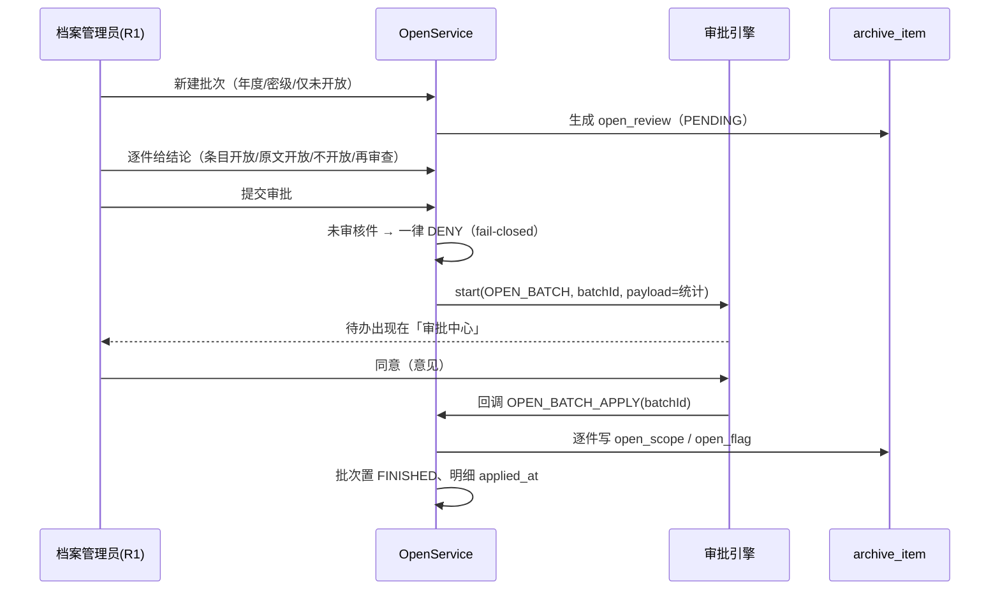
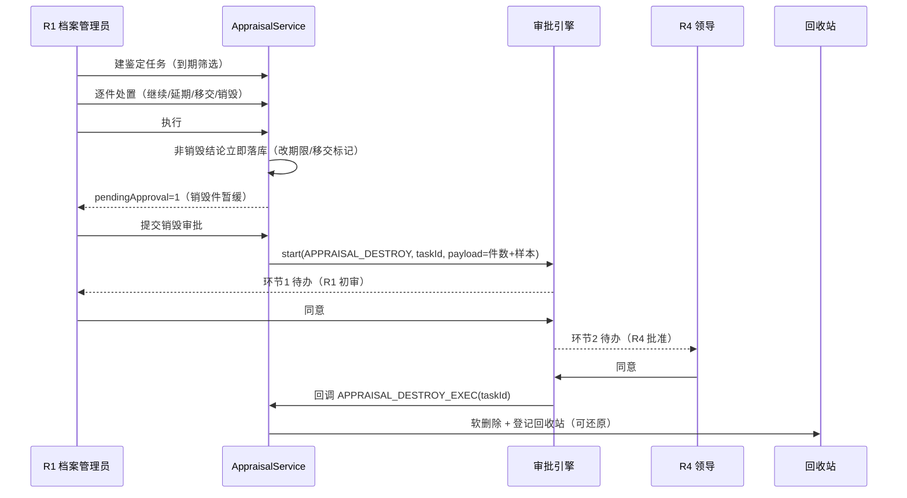

# 工作流与审批流设计

> 版本：v1.0（2026-11-13）
> 适用：天玑档案 v2.6 之后（P3 落地版本）
> 关联：`docs/系统架构设计.md`（§4 数据模型）、`docs/产品需求文档.md`（F-07）、`docs/P3-P4统一测试手册.md`

---

## 0. 先看这张全景图：系统里一共有几条"流程"

天玑里存在**两类**流转，很多人会把它们混为一谈，实际职责完全不同：

| 类别 | 是什么 | 谁驱动 | 例子 |
|---|---|---|---|
| **档案业务状态机** | 档案本身的**状态**（未处理/预归档/待审核/已归档） | R1/R2 直接点按钮 | 收集链路 P1 |
| **审批流（引擎）** | 一次**决策**需要多人按顺序表态 | 引擎按环节派单 | 开放批次、销毁 |

```
                       ┌──────────────── 档案业务状态机（P1）────────────────┐
  未处理 DRAFT ──预归档──▶ 预归档 PRE_ARCHIVED ──提交审核──▶ 待审核 SUBMITTED ──▶ 已归档 ARCHIVED
      └────────── 确认归档（可跨态直达）──────────────────────────────────────────┘
              └── 无需归档 NO_ARCHIVE（旁路，可撤回）

                       ┌──────────────── 审批流引擎（P3）──────────────────┐
  业务单据 ──submit──▶ 实例 RUNNING ──环节1通过──▶ 环节2通过 ──▶ APPROVED ──▶ 回调落库
                            └──驳回──▶ REJECTED          └──撤回──▶ CANCELLED
```

**边界铁律**：状态机负责「档案现在处于什么阶段」，审批流负责「这个决定谁同意了」。
两者不互相嵌套 —— 引擎不认识 `archive_item`，业务模块也不认识 `workflow_node`，
只通过「起流程 / 查结论 / 注册回调」三件事交互。

---

## 1. 全部流程清单（当前已实现）

| 编号 | 流程 | 承载方式 | 触发入口 | 环节 | 通过后做什么 |
|---|---|---|---|---|---|
| W-01 | 归档收集 | 业务状态机（P1） | 著录页按钮 | 无审批环节，R1 确认即归档 | 写 `archived_by/at`，同步索引 |
| W-02 | 借阅审批 | **专用两级审批**（F-06） | 借阅页「申请」 | 按密级路由：公开/内部 1 级，秘密 2 级 | 状态转 APPROVED，可办理借出 |
| W-03 | 开放批次审批 | **引擎** `WF-OPEN-BATCH` | 开放管理「提交审批」 | 1 环节：R1 档案管理员审核 | 应用开放标识（`open_scope`） |
| W-04 | 鉴定销毁审批 | **引擎** `WF-APPRAISAL-DESTROY` | 鉴定页「提交销毁审批」 | 2 环节：R1 初审 → R4 批准 | 执行软删除 + 入回收站 |
| W-05 | 回收站清理 | 定时任务（非流程） | 每日 03:20 | 无 | 到期物理删除 |
| W-06 | 借阅逾期 | 定时任务（非流程） | 每分钟心跳判定 | 无 | 状态转 OVERDUE |

> W-02 为什么暂不迁到引擎：借阅审批的「级数由密级决定」是**数据驱动**的，
> 用固定环节表达会出现「公开件也要两级」的错配。现有两级实现已带 CAS 与次序校验，
> 迁移收益低于风险。引擎的 `BORROW` 业务类型已预留，后续可按密级配两条流程再切。

---

## 2. 审批流引擎

### 2.1 数据模型（四表）

```
workflow_def（流程类型） 1 ──── N workflow_node（环节）
      │                              │
      │ 1                            │ id
      ▼                              ▼
workflow_instance（一次决策） 1 ──── N workflow_task（每环节一条待办）
```

| 表 | 关键字段 | 说明 |
|---|---|---|
| `workflow_def` | `code`(唯一)、`biz_type`、`version`、`enabled` | 一种业务同时只允许**一条** `enabled=true`；改流程 `version+1` |
| `workflow_node` | `seq`(从 1 连续)、`role_code`、`perm_domain`、`on_approve`、`allow_reject`、`timeout_hours` | `role_code='*'` 表示不限角色；`on_approve` 只在**末环节**生效 |
| `workflow_instance` | `biz_type`+`biz_id`、`status`、`current_seq`、`payload` | `payload` 存提交时的快照（件数、样本档号），审批人不用回查业务表 |
| `workflow_task` | `instance_id`、`seq`、`node_name`、`role_code`、`status`、`acted_by/opinion/acted_at` | **岗位待办池**：同角色共享一条待办，先办先得 |

### 2.2 状态机

```
                     ┌──────────── 驳回（allow_reject=true 的环节）────────────┐
                     ▼                                                        │
  RUNNING ──末环节通过──▶ APPROVED ──▶ 触发 on_approve 回调（业务落库）        │
     │                                                                        │
     ├──发起人/R0 撤回──▶ CANCELLED                                            │
     └────────────────────────────── REJECTED ◀────────────────────────────────┘
```

`workflow_task` 状态：`PENDING`（待办）→ `APPROVED` / `REJECTED`；撤回时未处理环节置 `SKIPPED`。

### 2.3 推进逻辑（`WorkflowService.act`）

一次审批动作在**单个事务**内完成以下五步，任一不过即整笔拒绝：

1. `SELECT ... FOR UPDATE` 锁 `workflow_instance` 行；
2. 实例必须 `RUNNING`（否则「已通过/已驳回」不能重复处理）；
3. 当前 `current_seq` 必须存在 `PENDING` 待办（挡住「两个人同时点同意」把流程推进两格）；
4. 处理人须满足环节要求：
   - `role_code` 命中用户角色（`'*'` 跳过）；
   - 若 `perm_domain` 非空，须具备该域 `APPROVE` 或 `WRITE` 权限（如 `APPRAISAL`）；
5. 驳回时校验 `allow_reject` 且**意见必填**。

通过后：存在 `seq+1` 则生成下一环节待办并更新 `current_seq`；不存在则实例置 `APPROVED`。

> **为什么锁实例行**：审批系统最常见的事故是「双开页面 + 两人同时点通过」，
> 流程被推进两格，中间环节等于没人审。锁行 + 待办状态校验是唯一可靠的挡法，
> 仅靠前端置灰不行（两个浏览器互不可见）。

### 2.4 回调（业务落库）

```
审批最后环节通过 ──▶ 事务提交 ──▶ fireCallback(instance)
                                     │ 读末环节 on_approve
                                     ▼
                        Map<key, handler>（业务模块注册）
                                     │
              ┌──────────────────────┼───────────────────────┐
              ▼                      ▼                       ▼
   OPEN_BATCH_APPLY        APPRAISAL_DESTROY_EXEC        （未来新增）
   应用 open_scope          软删除 + 入回收站
```

设计要点：

- **在事务外执行**：审批结论已成事实，不能因为业务落库失败把审批回滚；
  回调抛错只记 `ERROR` 日志，由运维按日志重放（回调必须幂等）。
- **回调必须幂等**：`OPEN_BATCH_APPLY` 只处理 `applied_at IS NULL` 的明细；
  `APPRAISAL_DESTROY_EXEC` 只处理 `executed = false` 的销毁明细。重复调用安全。
- **注册方式**：业务模块 `onModuleInit` 里 `workflow.registerCallback(key, handler)`；
  引擎启动日志会打印已注册回调清单，便于现场核对。
- **未注册即告警**：若末环节声明了 `on_approve` 但没有 handler，
  引擎打印 `审批回调未注册：xxx（实例 yyy），业务落库需人工处理` ——
  宁可吵，也不能静默吞掉一个「审批过了但没执行」的销毁。

### 2.5 超时策略

`WorkflowScheduler` 每小时第 20 分扫描一次：环节声明了 `timeout_hours` 且待办超时的，
**只打 WARN 日志，不自动流转**。

> 理由：档案审批是责任行为。自动「视为同意」会把「没人看」变成「已批准」，
> 在监管检查中属于重大缺陷。催办靠人，系统只负责提醒。

---

## 3. 各流程详解

### 3.1 W-03 开放批次审批（`WF-OPEN-BATCH`）



关键业务口径：

| 结论 | `open_scope` | `open_flag` | 含义 |
|---|---|---|---|
| 条目开放 | `ENTRY` | `OPEN` | 目录可检索，原文仍受控 |
| 原文开放 | `FULLTEXT` | `OPEN` | 目录 + 全文均可在线利用 |
| 不开放 | `NONE` | `CONTROLLED` | 控制使用，须记理由 |
| 再审查 | 不变 | 不变 | 存疑挂起，进再审查队列 |

- **未审核 = 不开放**：提交审批时把 `PENDING` 一律收口为 `DENY`，理由写明
  「批次提交时未审核，默认控制使用」。开放是授权扩大，「忘了审」不能变成「默认开放」。
- **审批看到的必须等于应用的**：`APPROVING` 状态禁止再改结论；要改先撤回审批。
- **再审查不改判**：同一批次内一件只有一个结论；补依据后**新建批次**重审，
  这样「上次为什么没开放」不会被覆盖。

### 3.2 W-04 鉴定销毁审批（`WF-APPRAISAL-DESTROY`）



为什么是「先执行、销毁后补审批」而不是「全部审批完才执行」：

- 继续保管/延期/移交是**低风险**动作，卡在审批里会让整批鉴定停摆；
- 销毁是唯一不可逆动作，单独审；
- 执行结果里会明确给出 `pendingApproval` 件数，前端提示「N 件销毁待审批」。

销毁是**软删除**：进回收站（默认保留 30 天，由 `recycle.retention_days` 参数控制），
回收站「彻底销毁」才是物理删除。这给了「误销毁」一个可恢复窗口。

### 3.3 W-02 借阅审批（F-06，专用实现）

```
PENDING ──(level 1 通过，requiredLevel=1)──▶ APPROVED ──登记借出──▶ LENT ──归还──▶ RETURNED
   │            └─(requiredLevel=2)──▶ 仍 PENDING，currentLevel=2 ──(level 2 通过)──▶ APPROVED
   ├──驳回──▶ REJECTED
   └──申请人撤销──▶ CANCELLED
LENT ──逾期扫描──▶ OVERDUE ──归还──▶ RETURNED
```

- 级数由**密级**决定：`PUBLIC/INTERNAL → 1 级`，`SECRET → 2 级`；
- 审批带 CAS（`WHERE status + current_level` 为读取值），多实例安全；
- 归还与续借规则参数化（`sys_param`：总借期/续借次数/单次续借天数/默认借期/提醒天数），
  前端通过 `GET /borrow/config` 拿同一份口径，避免文案与校验漂移；
- 借阅动作全部进审计（`@Audit` 装饰器 + `mandatory`）。

### 3.4 W-01 归档状态机（P1 回顾，非审批）

| 动作 | 来源状态 | 目标状态 | 权限 |
|---|---|---|---|
| 预归档 | DRAFT | PRE_ARCHIVED | ITEM WRITE |
| 撤消预归档 | PRE_ARCHIVED | DRAFT | ITEM WRITE |
| 提交审核 | DRAFT / PRE_ARCHIVED | SUBMITTED | ITEM WRITE |
| 审核不通过（必填原因） | SUBMITTED | DRAFT | ARCHIVE_CONFIRM |
| 确认归档 | DRAFT / PRE_ARCHIVED / SUBMITTED | ARCHIVED | ARCHIVE_CONFIRM（R1） |
| 无需归档 | DRAFT | NO_ARCHIVE | ITEM WRITE |
| 撤回未处理 | NO_ARCHIVE | DRAFT | ITEM WRITE |

实现：`ITEM_STAGE_TRANSITIONS` 是唯一迁移表，`ArchiveService.transitionStage` 是唯一入口，
事务内 `SELECT FOR UPDATE` + 逐行 CAS + 同事务写 `item_stage_log`（只插不改删）。

---

## 4. 配置指南（运营视角）

### 4.1 在页面上改流程

「审批中心 → 流程配置」：可编辑环节名称、处理角色、权限域、通过回调、是否允许驳回。

- 保存后 `version + 1`，**在途实例仍按原环节继续**（实例持有 `def_id`，环节按 `def_id+seq` 查）；
- 启用某流程会自动停用同 `biz_type` 的其他流程（避免 `activeDef` 取哪条成为随机行为）；
- 有在途实例的流程**不能删除**，只能停用。

### 4.2 新增一种业务审批（开发步骤）

1. 在 `packages/shared/src/enums.ts` 的 `WorkflowBizType` 增加枚举 + 中文标签；
2. 业务表加 `workflow_instance_id`（可选，便于列表展示审批状态）；
3. 业务 service 注入 `WorkflowService`：
   - `start({ bizType, bizId, title, summary, payload })` 发起；
   - `findForBiz(bizType, bizId)` 查结论（用于「能否执行」的准入判断）；
4. 若审批通过后需要落库，在 `WorkflowCallback` 增加键，并在业务模块
   `onModuleInit` 里 `registerCallback(key, handler)`，handler 必须幂等；
5. 插入一条 `workflow_def` + 若干 `workflow_node`（末环节写 `on_approve`）；
6. 前端：业务页面加「提交审批」，`审批中心` 无需改动（通用列表自动出现）。

### 4.3 角色与权限矩阵（审批相关）

| 角色 | 开放批次 | 鉴定销毁 | 借阅 | 说明 |
|---|---|---|---|---|
| R0 系统管理员 | 配置流程 | 配置流程 | — | 不接触档案内容，不参与业务审批 |
| R1 档案管理员 | 审核 + 提交 | 初审 + 提交 | 可审批 | 主责岗位 |
| R2 部门兼职档案员 | — | — | 可申请 | 数据范围受限（按全宗） |
| R3 借阅用户 | — | — | 申请 | 无 ITEM 权限，走检索/借阅域 |
| R4 领导/查档审批人 | — | 批准 | 可审批 | 终审岗 |

---

## 5. API 一览

| 方法 | 路径 | 权限 | 说明 |
|---|---|---|---|
| GET | `/api/workflow/defs` | PARAM READ | 流程定义列表（含环节） |
| POST | `/api/workflow/defs` | PARAM WRITE | 新建流程 |
| PATCH | `/api/workflow/defs/:id` | PARAM WRITE | 改流程（可只传 `nodes` / `enabled`） |
| DELETE | `/api/workflow/defs/:id` | PARAM DELETE | 删除（有在途实例拒绝） |
| GET | `/api/workflow/instances` | 登录即可 | 实例列表（`mine=1` 只看我相关） |
| GET | `/api/workflow/instances/:id` | 登录即可 | 实例详情 + 时间线 |
| POST | `/api/workflow/instances/:id/action` | APPRAISAL APPROVE（alt: BORROW_APPROVE） | 通过/驳回 |
| POST | `/api/workflow/instances/:id/cancel` | 发起人/R0 | 撤回 |
| GET | `/api/workflow/tasks/my` | 登录即可 | 我的待办（按角色池） |
| GET | `/api/workflow/biz/:bizType/:bizId` | 登录即可 | 某单据的审批轨迹 |
| POST | `/api/appraisal/tasks/:id/submit-destroy` | APPRAISAL WRITE | 提交销毁审批 |
| POST | `/api/open/batches/:id/submit` | APPRAISAL WRITE | 提交开放批次审批 |

冒烟示例：

```bash
TOKEN=$(curl -s -X POST http://127.0.0.1:3000/api/auth/login \
  -H 'content-type: application/json' \
  -d '{"username":"archivist1","password":"Tianji@Test1"}' | jq -r .data.accessToken)

# 我的待办
curl -s http://127.0.0.1:3000/api/workflow/tasks/my -H "authorization: Bearer $TOKEN" | jq '.data | length'

# 审批通过
curl -s -X POST http://127.0.0.1:3000/api/workflow/instances/$INST/action \
  -H "authorization: Bearer $TOKEN" -H 'content-type: application/json' \
  -d '{"action":"APPROVE","opinion":"同意"}' | jq '.data.status'
```

---

## 6. 排错手册

| 现象 | 根因 | 处理 |
|---|---|---|
| 提交时报「未配置启用中的审批流程」 | 该 `biz_type` 没有 `enabled=true` 的 def | 流程配置里启用，或插入种子 |
| 提交时报「已有流转中的审批」 | 同一 bizId 已有 RUNNING 实例 | 先撤回或处理完旧实例；这是防双写的必要约束 |
| 待办列表为空但实例 RUNNING | 环节 `role_code` 与当前账号角色不匹配 | 换对应角色账号，或改环节角色 |
| 点同意报 403「需 XX 角色处理」 | 角色不匹配或 `perm_domain` 权限不足 | 用 R1/R4 账号；确认该角色有 `APPRAISAL` 权限 |
| 点同意报「当前环节没有待办」 | 已被他人处理（并发）或页面停留过久 | 刷新列表；这是锁行保护，不是 bug |
| 审批已通过但业务没落库 | 回调未注册 / 回调抛错 | 查日志 `审批回调未注册` / `审批回调失败`；修复后调业务的手动重试接口（如 `/open/batches/:id/apply`） |
| 流程改了但在途单据还走旧环节 | 设计如此（版本隔离） | 如需改在途，撤回后重新发起 |
| 超时没人催 | 环节未配 `timeout_hours` | 在流程配置里补；调度器每小时告警一次 |

---

## 7. 已知边界与后续

1. **不支持并行网关/会签**：当前是严格顺序单线流转。档案审批实际不需要会签
   （「三人同时审」在责任认定上更麻烦），如未来需要，`workflow_task` 已按环节多条存储，
   加 `mode` 字段即可扩展。
2. **借阅审批未接入引擎**：见 §1 注。切换时要按密级配两条流程并保留 CAS 语义。
3. **审批不含附件/电子签章**：利用单打印为纸质签字留痕，电子签章属 P5 范畴。
4. **无移动端推送**：待办靠页面轮询；接入企业微信/邮件通知需新增 adapter（接口已留 `notify` 位）。
