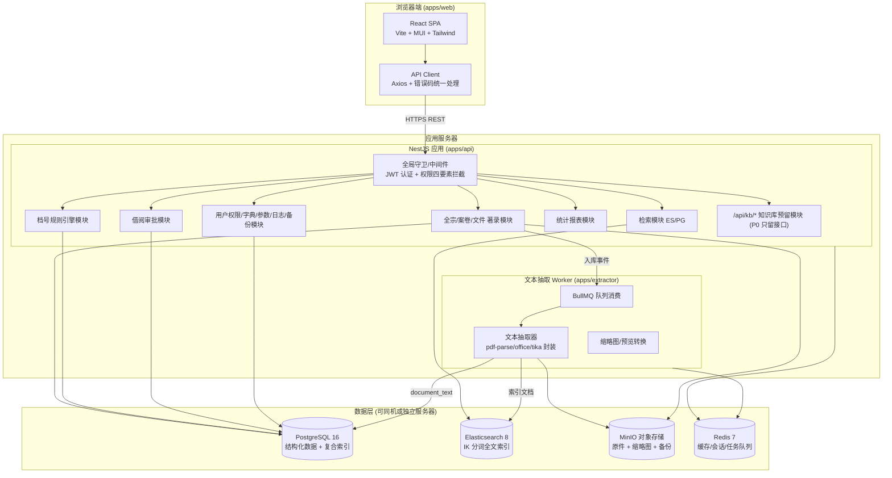
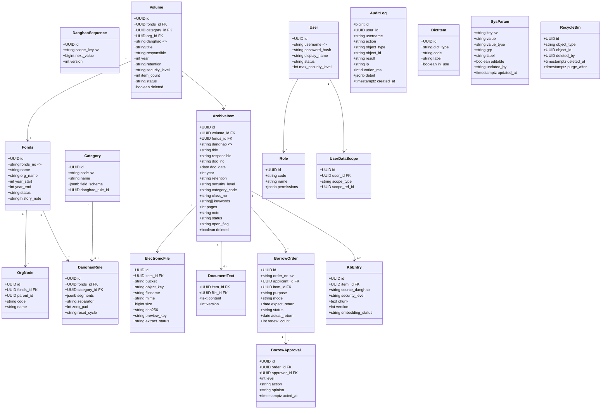
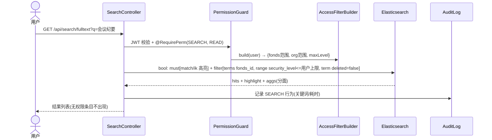
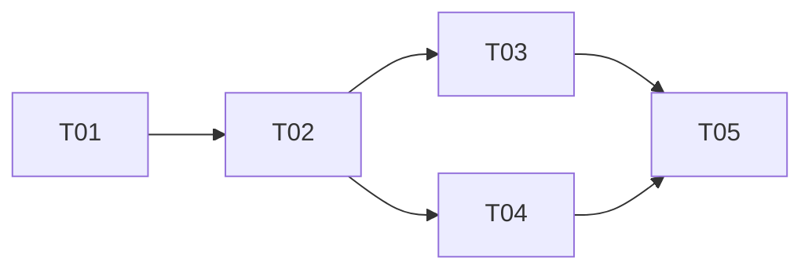

# 系统架构设计文档 —— 天玑档案管理系统本地复刻

> 版本：v1.0 ｜ 架构师：高见远 ｜ 输入：docs/产品需求文档.md v1.0 ｜ 状态：待评审
> 技术栈已由主理人决策锁定：Vite + React 18 + MUI + Tailwind / NestJS (Node 22 LTS) + TypeORM / PostgreSQL 16 / Elasticsearch 8 / MinIO / Docker Compose。

---

## 1. 总体架构

### 1.1 架构分层与组件图



**部署形态**：Docker Compose 编排 8 个服务（web/nginx、api、extractor、postgres、elasticsearch、minio、redis、备份 sidecar cron）。单服务器可承载 P0；数据量增长后 PG/ES/MinIO 迁数据服务器，docker-compose 拆分 profile 即可，无需改代码。

### 1.2 关键技术挑战与选型论证

| 挑战 | 决策 | 理由 |
|---|---|---|
| 档号并发不重号 | DB 序列表 + 唯一约束 + `SELECT ... FOR UPDATE` 行锁（行存于 `danghao_sequence`） | 比应用锁可靠，重启/多实例安全；冗余唯一索引兜底 |
| 权限四要素统一拦截 | NestJS Guard + 装饰器 `@RequirePerm({domain, op})`，数据范围/密级转换为 SQL 过滤条件与 ES filter query | 服务端单点拦截，前端仅展示态；RAG/检索复用同一 `AccessFilterBuilder` |
| 百万级全文 P95<2s | ES 8 单索引 3 分片 + IK max_word，metadata 字段做 keyword 分面，正文 ngram 不建 | 见 §7 |
| 100GB 存量迁移 | P0-A 交付 CLI 迁移工具（apps/cli-migrator），分片上传 MinIO + 断点续传 + SHA-256 校验报告 | 上线前置条件 |
| 国产库可迁移 | 选 **TypeORM**（不用 Prisma）：DataSource 方言隔离，禁写原生 PG 专有 SQL（除序列/全文个别处经 Repository 层封装），达梦/人大金仓均有兼容 driver | PM 决策点 |
| 大文件上传 | 前端分片 5MB → MinIO multipart（S3 API 预签名直传），API 只签发凭证不过流 | NFR-6，减轻 API 服务器压力 |
| Office 预览 | LibreOffice headless 转 PDF 任务进 worker，缓存到 MinIO `preview/` 前缀 | 可降级为下载 |

---

## 2. 技术选型清单与版本

| 层 | 技术 | 版本 | 用途 |
|---|---|---|---|
| 前端 | React / Vite / TypeScript | 18.3 / 5.x / 5.x | SPA |
| 前端 | MUI / Tailwind CSS | 5.16 / 3.4 | 组件库 / 原子样式（MUI 组件 + Tailwind 布局微调，theme 统一深靛蓝主色） |
| 前端 | TanStack Query / Zustand / React Router / Axios / ECharts | 5.x / 4.x / 6.x / 1.x / 5.x | 数据请求 / 轻量状态 / 路由 / HTTP / 报表图表 |
| 前端 | react-pdf / pdfjs-dist | 9.x | PDF 预览 |
| 后端 | NestJS / Node | 10.x / 22 LTS | API 框架（模块化 + Guard/Interceptor 体系匹配权限与日志需求） |
| 后端 | TypeORM | 0.3.x | ORM，方言隔离 |
| 后端 | @nestjs/bullmq + bullmq / ioredis | 10.x / 5.x / 5.x | 异步任务（抽取、转换、备份、批量导入） |
| 后端 | @nestjs/jwt + passport / class-validator / helmet | 10.x / 0.5 | 认证 / DTO 校验 / 安全头 |
| 后端 | @elastic/elasticsearch | 8.x | 全文检索客户端 |
| 后端 | minio (js sdk) | 8.x | 对象存储 |
| 数据库 | PostgreSQL | 16 | 主库 |
| 检索 | Elasticsearch + IK 插件 | 8.13.x | 全文索引 |
| 缓存/队列 | Redis | 7 | 缓存、会话、BullMQ |
| 存储 | MinIO | RELEASE 2024+ | S3 兼容对象存储，NAS 可挂载为后端盘 |
| 运维 | Docker Compose / Nginx | 2.x / 1.25 | 编排 / 反向代理 + HTTPS 终止 + 静态资源 |

---

## 3. 文件列表（pnpm monorepo）

```
tianji_archive_local/
├── package.json                     # workspaces 根
├── pnpm-workspace.yaml
├── docker-compose.yml               # 一键部署
├── .env.example
├── apps/
│   ├── web/
│   │   ├── package.json
│   │   ├── vite.config.ts
│   │   ├── tailwind.config.ts
│   │   ├── tsconfig.json
│   │   ├── index.html
│   │   └── src/
│   │       ├── main.tsx
│   │       ├── App.tsx
│   │       ├── router.tsx                    # 路由 + 权限路由守卫
│   │       ├── theme.ts                      # MUI 主题（深靛蓝）
│   │       ├── api/client.ts                 # axios 实例 + 错误码/刷新 token 拦截
│   │       ├── api/types.ts                  # 共享 DTO 类型 re-export
│   │       ├── stores/authStore.ts           # 登录态/权限点
│   │       ├── components/AppLayout.tsx      # 顶栏+侧导航+主区
│   │       ├── components/PermGate.tsx       # 按钮级权限置灰 + title 原因
│   │       ├── components/ArchiveNo.tsx      # 档号展示组件
│   │       ├── components/FileUploader.tsx   # 分片上传
│   │       ├── components/FilePreview.tsx    # PDF/图片/音视频/Office 预览
│   │       ├── components/MetadataForm.tsx   # 按门类动态渲染著录表单（核心字段不可裁剪）
│   │       ├── pages/Dashboard.tsx           # F-13 工作台
│   │       ├── pages/fonds/FondsList.tsx     # F-01
│   │       ├── pages/catalog/VolumeList.tsx  # F-03 案卷
│   │       ├── pages/catalog/ItemEditor.tsx  # F-04 件级著录（左右分栏）
│   │       ├── pages/catalog/RuleConfig.tsx  # F-02 档号规则配置与试算
│   │       ├── pages/search/SearchPage.tsx   # F-05 综合检索（分面/高亮/导出）
│   │       ├── pages/borrow/BorrowPage.tsx   # F-06 借阅四 Tab
│   │       ├── pages/report/ReportPage.tsx   # F-07 统计报表
│   │       ├── pages/system/Users.tsx        # F-09
│   │       ├── pages/system/Roles.tsx        # 权限矩阵
│   │       ├── pages/system/Dicts.tsx        # F-14
│   │       ├── pages/system/AuditLogs.tsx    # F-10
│   │       ├── pages/system/Backup.tsx       # F-11
│   │       └── pages/system/Params.tsx
│   ├── api/
│   │   ├── package.json
│   │   ├── tsconfig.json
│   │   ├── nest-cli.json
│   │   └── src/
│   │       ├── main.ts                       # helmet/validation/cors/全局前缀 /api
│   │       ├── app.module.ts
│   │       ├── config/configuration.ts       # 环境配置外置
│   │       ├── common/
│   │       │   ├── guards/jwt-auth.guard.ts
│   │       │   ├── guards/permission.guard.ts      # 四要素拦截（核心）
│   │       │   ├── decorators/require-perm.decorator.ts
│   │       │   ├── interceptors/audit-log.interceptor.ts  # 全量留痕
│   │       │   ├── filters/http-exception.filter.ts       # {code,data,message}
│   │       │   ├── access/access-filter.builder.ts        # 数据范围×密级 → SQL/ES filter（RAG 复用）
│   │       │   └── constants/enums.ts                    # 密级/保管期限/操作/错误码
│   │       ├── modules/
│   │       │   ├── auth/        # 登录/刷新/密码策略（controller+service+module 3 文件）
│   │       │   ├── user/        # 用户/角色/数据范围授权
│   │       │   ├── fonds/       # F-01 全宗 + 机构树
│   │       │   ├── category/    # F-12 门类/分类方案 + 字段集
│   │       │   ├── danghao/     # F-02 规则引擎 + 序列分配（rule.service/sequence.service）
│   │       │   ├── archive/     # F-03/F-04 案卷/文件著录、作废重编、批量修改
│   │       │   ├── file/        # F-08 电子文件、预签名上传、预览、水印、四性接口
│   │       │   ├── search/      # F-05 ES 检索 + PG 条件检索 + 检索历史
│   │       │   ├── borrow/      # F-06 状态机
│   │       │   ├── report/      # F-07 统计
│   │       │   ├── dict/        # F-14
│   │       │   ├── audit/       # F-10 日志查询/归档
│   │       │   ├── backup/      # F-11 策略/执行/恢复记录
│   │       │   └── kb/          # /api/kb/* 预留：EmbeddingProvider/VectorStore 接口 + 空实现
│   │       └── infra/
│   │           ├── database/typeorm.module.ts
│   │           ├── elasticsearch/es.service.ts   # 索引初始化 + IK mapping
│   │           ├── storage/minio.service.ts
│   │           └── queue/queue.module.ts         # BullMQ 注册
│   ├── extractor/
│   │   ├── package.json
│   │   └── src/
│   │       ├── main.ts                      # 独立进程，消费 BullMQ
│   │       ├── extract.processor.ts         # 抽取 → document_text → ES 索引
│   │       ├── converters/pdf.converter.ts
│   │       ├── converters/office.converter.ts  # LibreOffice 子进程
│   │       ├── converters/image.converter.ts   # 缩略图
│   │       └── converters/av.converter.ts      # ffmpeg 转码
│   └── cli-migrator/
│       ├── package.json
│       └── src/
│           ├── cli.ts                       # commander 入口：import-catalog / import-files / verify
│           ├── excel.reader.ts              # 目录 Excel 解析 + 逐行校验
│           ├── file.matcher.ts              # 目录树 ↔ 档号匹配挂接
│           ├── checkpoint.ts                # 断点续传（SQLite 本地状态）
│           └── report.ts                    # 校验/比对报告
├── packages/
│   └── shared/
│       ├── package.json
│       └── src/
│           ├── enums.ts        # 密级/保管期限/借阅状态/操作类型
│           ├── danghao.ts      # 档号段常量、模板解析器（前后端共用试算）
│           ├── errors.ts       # 错误码表
│           └── dto.ts          # 跨端 DTO
└── docs/
    ├── 产品需求文档.md
    ├── 系统架构设计.md
    ├── 类图.mermaid
    └── 时序图.mermaid
```

---

## 4. 数据模型

### 4.1 ER / 类图（另存 docs/类图.mermaid）



### 4.2 核心表 DDL（要点，迁移文件按此生成）

```sql
CREATE TABLE fonds (
  id UUID PRIMARY KEY DEFAULT gen_random_uuid(),
  fonds_no VARCHAR(32) NOT NULL UNIQUE,
  name VARCHAR(200) NOT NULL,
  org_name VARCHAR(200),
  year_start INT, year_end INT,
  status VARCHAR(16) NOT NULL DEFAULT 'ACTIVE',   -- ACTIVE/DISABLED(停用可检索不可新增)
  history_note TEXT,
  created_at TIMESTAMPTZ NOT NULL DEFAULT now(), updated_at TIMESTAMPTZ NOT NULL DEFAULT now()
);

CREATE TABLE danghao_rule (
  id UUID PRIMARY KEY DEFAULT gen_random_uuid(),
  fonds_id UUID NOT NULL REFERENCES fonds(id),
  category_id UUID REFERENCES category(id),
  segments JSONB NOT NULL,          -- [{type:'FONDS'|'CATALOG'|'YEAR'|'ORG'|'RETENTION'|'VOLUME'|'ITEM', pad:4}]
  separator VARCHAR(4) NOT NULL DEFAULT '-',
  reset_cycle VARCHAR(16) NOT NULL DEFAULT 'YEAR',  -- YEAR/VOLUME/NEVER
  created_at TIMESTAMPTZ NOT NULL DEFAULT now()
);

CREATE TABLE danghao_sequence (
  id UUID PRIMARY KEY DEFAULT gen_random_uuid(),
  scope_key VARCHAR(200) NOT NULL UNIQUE,  -- 规则前缀,如 'A036-2024-BGS-Y'
  next_value BIGINT NOT NULL DEFAULT 1
);

CREATE TABLE volume (
  id UUID PRIMARY KEY DEFAULT gen_random_uuid(),
  fonds_id UUID NOT NULL REFERENCES fonds(id),
  category_id UUID REFERENCES category(id),
  org_id UUID REFERENCES org_node(id),
  danghao VARCHAR(120) NOT NULL UNIQUE,     -- 入库不可改，只能作废重编
  title VARCHAR(500) NOT NULL,
  responsible VARCHAR(200), year INT NOT NULL,
  retention VARCHAR(16) NOT NULL,            -- PERM/Y30/Y10
  security_level VARCHAR(16) NOT NULL DEFAULT 'PUBLIC', -- PUBLIC/INTERNAL/SECRET
  item_count INT NOT NULL DEFAULT 0,
  status VARCHAR(16) NOT NULL DEFAULT 'DRAFT',  -- DRAFT/ARCHIVED/VOID
  deleted BOOLEAN NOT NULL DEFAULT FALSE,
  created_by UUID, created_at TIMESTAMPTZ NOT NULL DEFAULT now(), updated_at TIMESTAMPTZ NOT NULL DEFAULT now()
);

CREATE TABLE archive_item (
  id UUID PRIMARY KEY DEFAULT gen_random_uuid(),
  volume_id UUID REFERENCES volume(id),
  fonds_id UUID NOT NULL REFERENCES fonds(id),
  danghao VARCHAR(120) NOT NULL UNIQUE,
  title VARCHAR(500) NOT NULL,
  responsible VARCHAR(200), doc_no VARCHAR(120), doc_date DATE,
  year INT NOT NULL, retention VARCHAR(16) NOT NULL,
  security_level VARCHAR(16) NOT NULL DEFAULT 'PUBLIC',
  category_code VARCHAR(32), class_no VARCHAR(64),
  keywords TEXT[], pages INT, note TEXT,
  status VARCHAR(16) NOT NULL DEFAULT 'DRAFT',   -- DRAFT/SUBMITTED/ARCHIVED/VOID
  open_flag VARCHAR(16) NOT NULL DEFAULT 'CONTROLLED',  -- OPEN/CONTROLLED (F-19)
  deleted BOOLEAN NOT NULL DEFAULT FALSE,
  created_by UUID, created_at TIMESTAMPTZ NOT NULL DEFAULT now(), updated_at TIMESTAMPTZ NOT NULL DEFAULT now()
);
-- 条件检索复合索引（P95<1s 承诺）
CREATE INDEX idx_item_query ON archive_item (fonds_id, year, retention, security_level, category_code) WHERE deleted = FALSE;
CREATE INDEX idx_item_date ON archive_item (doc_date);
CREATE INDEX idx_item_volume ON archive_item (volume_id);

CREATE TABLE electronic_file (
  id UUID PRIMARY KEY DEFAULT gen_random_uuid(),
  item_id UUID NOT NULL REFERENCES archive_item(id),
  bucket VARCHAR(64) NOT NULL, object_key VARCHAR(500) NOT NULL,
  filename VARCHAR(300) NOT NULL, mime VARCHAR(120), size BIGINT NOT NULL,
  sha256 CHAR(64) NOT NULL,                      -- 四性-完整性基线
  preview_key VARCHAR(500), thumb_key VARCHAR(500),
  extract_status VARCHAR(16) NOT NULL DEFAULT 'PENDING', -- PENDING/OK/FAILED
  created_at TIMESTAMPTZ NOT NULL DEFAULT now(),
  UNIQUE (bucket, object_key)
);

CREATE TABLE document_text (
  id UUID PRIMARY KEY DEFAULT gen_random_uuid(),
  item_id UUID NOT NULL REFERENCES archive_item(id),
  file_id UUID REFERENCES electronic_file(id),
  content TEXT NOT NULL, version INT NOT NULL DEFAULT 1,
  created_at TIMESTAMPTZ NOT NULL DEFAULT now()
);

CREATE TABLE borrow_order (
  id UUID PRIMARY KEY DEFAULT gen_random_uuid(),
  order_no VARCHAR(40) NOT NULL UNIQUE,
  applicant_id UUID NOT NULL REFERENCES app_user(id),
  item_id UUID NOT NULL REFERENCES archive_item(id),
  purpose VARCHAR(500) NOT NULL,
  mode VARCHAR(16) NOT NULL,                    -- ONLINE/ORIGINAL
  expect_return DATE NOT NULL, actual_return TIMESTAMPTZ,
  status VARCHAR(20) NOT NULL DEFAULT 'PENDING',-- PENDING/APPROVED/REJECTED/LENT/RETURNED/OVERDUE/CANCELLED
  renew_count INT NOT NULL DEFAULT 0,
  created_at TIMESTAMPTZ NOT NULL DEFAULT now()
);

CREATE TABLE app_user (
  id UUID PRIMARY KEY DEFAULT gen_random_uuid(),
  username VARCHAR(64) NOT NULL UNIQUE,
  password_hash VARCHAR(120) NOT NULL,          -- bcrypt/argon2 加盐
  display_name VARCHAR(64) NOT NULL,
  status VARCHAR(16) NOT NULL DEFAULT 'ACTIVE',
  max_security_level VARCHAR(16) NOT NULL DEFAULT 'PUBLIC',
  pwd_changed_at TIMESTAMPTZ, failed_count INT NOT NULL DEFAULT 0,
  created_at TIMESTAMPTZ NOT NULL DEFAULT now()
);

CREATE TABLE role (
  id UUID PRIMARY KEY DEFAULT gen_random_uuid(),
  code VARCHAR(32) NOT NULL UNIQUE,             -- R0..R4
  name VARCHAR(64) NOT NULL,
  permissions JSONB NOT NULL                    -- [{domain:'ARCHIVE', ops:['READ','WRITE',...]}]
);
CREATE TABLE user_role (user_id UUID REFERENCES app_user(id), role_id UUID REFERENCES role(id), PRIMARY KEY(user_id, role_id));
CREATE TABLE user_data_scope (
  id UUID PRIMARY KEY DEFAULT gen_random_uuid(),
  user_id UUID NOT NULL REFERENCES app_user(id),
  scope_type VARCHAR(16) NOT NULL,              -- ALL/FONDS/ORG/SELF
  scope_ref_id UUID                             -- fonds_id 或 org_id
);

CREATE TABLE audit_log (                          -- 只追加，3 年留存，按月分区
  id BIGINT GENERATED ALWAYS AS IDENTITY,
  user_id UUID, username VARCHAR(64),
  action VARCHAR(32) NOT NULL,                  -- LOGIN/CREATE/UPDATE/DELETE/SEARCH/PREVIEW/DOWNLOAD/APPROVE/EXPORT/PERM_CHANGE
  object_type VARCHAR(32), object_id VARCHAR(64),
  result VARCHAR(16) NOT NULL, ip INET, duration_ms INT, detail JSONB,
  created_at TIMESTAMPTZ NOT NULL DEFAULT now()
) PARTITION BY RANGE (created_at);

CREATE TABLE kb_entry (                           -- P2 RAG 预留，P0 仅建表+接口
  id UUID PRIMARY KEY DEFAULT gen_random_uuid(),
  item_id UUID NOT NULL REFERENCES archive_item(id),
  source_danghao VARCHAR(120) NOT NULL,
  security_level VARCHAR(16) NOT NULL,
  chunk TEXT NOT NULL, version INT NOT NULL DEFAULT 1,
  embedding_status VARCHAR(16) NOT NULL DEFAULT 'NONE'
);
```

```sql
CREATE TABLE sys_param (                            -- 业务参数表（F-14），杜绝策略硬编码
  key VARCHAR(100) PRIMARY KEY,                     -- 如 borrow.max_total_days
  value TEXT NOT NULL,
  value_type VARCHAR(16) NOT NULL DEFAULT 'int',    -- int/string/bool/json
  grp VARCHAR(32) NOT NULL,                         -- borrow/preview/recycle/security/backup/log
  label VARCHAR(120) NOT NULL,
  editable BOOLEAN NOT NULL DEFAULT TRUE,           -- 合规固化参数置 FALSE（如 log.retention_years 下限）
  updated_by VARCHAR(64), updated_at TIMESTAMPTZ NOT NULL DEFAULT now()
);
```

> 四性检测预留：`electronic_file` 增加 `authenticity_check JSONB` 列与 `POST /api/files/:id/integrity-check` 接口桩（P0 实现完整性 SHA-256 比对，真实/可用/安全留扩展）。

### 4.3 业务参数清单（与 PRD 5.5 对齐：PRD 5.5 为取值与确认级别权威源，本节为技术实现源）

**参数化原则落地映射**（PRD 5.5.1 PR-P1~P8）：
- PR-P1 全可配：`sys_param` 表承载，业务代码禁止策略字面量（含 `BORROW_RULES` 类常量对象）。
- PR-P2 即时生效（≤60s）：ParamService Redis 缓存 60s + 保存时 pub/sub 主动失效（与权限失效共用 `param:invalidate` 通道）。
- PR-P3 变更留痕：参数变更走 AuditLogInterceptor，detail 记录 旧值/新值/原因（`sys_param` 仅存当前值，历史在 audit_log）。
- PR-P4 范围校验：合法区间定义在 `packages/shared` 的 PARAM_DEFS 常量（前后端同源校验），越界 400 拒绝，禁止静默落库。
- PR-P5 分级授权：grp=security/* 仅 R0 可改（@RequirePerm(PARAM, WRITE_SECURITY)），业务类 R1 可改。
- PR-P6 🔴 项评审后以确认值覆盖。
- PR-P7 合规固化：`log.retention_years` 在 PARAM_DEFS 中置 `editable=false`，管理端禁改。
- **PR-P8 安全类参数无缓存延迟（实现约定）**：ParamService 按 PARAM_DEFS 的 grp 分级读取——grp ∈ {security, preview} 的参数**直读数据库（绕过 Redis 缓存）**，辅以保存时 pub/sub 失效；其余 grp 走 60s 缓存 + 主动失效。安全组读取均在请求热路径但为单行主键查询，PG 耗时 <1ms，无性能顾虑。**反向约束：直读范围严格限定 {security, preview} 两组，borrow/recycle/backup/log 等组禁止直读**——borrow 类参数直读会使借期上限变更立刻作用于在途单逾期判定，违反 D-1（仅对新单生效）。

**存量生效口径（主理人裁定 G-1 总则 + D-1~D-7）**——"生效"在本项目分三种含义，验收口径按类推导（与 PM 商定）：
1. **读取生效**：新值能否被读到。`security.*`/`preview.*` 直读 DB 零窗口（PR-P8）；其余 60s 缓存 + 主动失效。
2. **存量失效**：已存在对象（会话/快照/在途请求）是否作废。**仅 D-4（权限）/D-6（水印/下载）需要**——权限快照主动失效（§8 双通道）、预览控制下一请求即按新值。
3. **判定生效**：新业务判定用新值、不回溯。D-1/D-2/D-5/D-7 及 D-3 均属此类。

映射：D-1/D-2/D-5/D-7 = 仅第 3 类；**D-3（会话超时）= 第 1+3 类**（存量会话按签发值走完不踢下线，新签发用新值；**验收禁止写成"改参数后立即 401"**）；**D-4/D-6 = 三类全占**（验收口径"撤权后下一请求即 403"仅适用于这两者）。G-1 总则中"安全类立即生效"的实际约束范围即 D-4/D-6。
- **数据保留类仅对增量生效（D-2/D-5/D-7，定时任务读当前值、不做历史快照）**：`recycle.retention_days`、`backup.keep_copies`、`log.retention_years`——清理任务每次运行按当前值计算新产生对象的到期时间；已产生的到期标记不重算。
- **借期上限（D-1）**：仅对"新申请/新续借"生效，在途已借出单据按原约定到期日履约，不回溯重判逾期。
- 其余（file 上限/import/log 阈值）：新请求/新任务生效。

**key 命名规范（权威）**：格式 `模块.属性_下划线`，模块段小写单词（borrow/preview/security/recycle/backup/file/import/log/search/extract），属性段下划线连写（如 `max_total_days`；PRD 封版中 `session_timeout_min`/`login_lock_min` 的 `min` 缩写作为例外保留，以 PRD key 为准）。`packages/shared` 的 `PARAM_DEFS` 为唯一定义源（key/默认值/区间/类型/grp/editable），后端 `PARAM_KEY` 常量、**种子数据**、管理端页面一律从 PARAM_DEFS 派生，**禁止各处手写字符串字面量；种子数据默认值与 §4.3 的一致性是强制要求（以本表为准），T02 验收含种子比对测试**。

**存量 key 迁移（防"改代码丢配置"）**：凡参数 key 变更（如本次 11 个旧 key 迁移），必须随代码同批交付 TypeORM migration 做数据搬迁 `UPDATE sys_param SET key=新key WHERE key=旧key`，并对无法映射的旧 key 行保留+告警日志；只改常量不搬数据会导致管理端查不到行、静默回落默认值，等同于丢失单位已配置值。两个特例：①`download.enabled`（bool）→ `preview.download_mode`（枚举）：`false→disabled`，`true→approval`；②`audit.retention.months` → `log.retention_years` 是**单位换算**而非改名，migration 必须 `value/12` 取整（36→3），禁止直接搬值（否则 36 会被当作 36 年）。

**参数主表**（22 项，key/默认值/区间/确认级别与 PRD 5.5.2 封版逐项一致；取值以 PRD 5.5 为准，落地以本节为准）：

| # | key | 默认值 | 合法区间 | 确认级别 | grp | 消费方（技术实现） |
|---|---|---|---|---|---|---|
| 1 | borrow.max_total_days | 90 | 1–365 | 🔴 | borrow | BorrowService 状态机/逾期判定/报表口径（D-1 仅新单生效） |
| 2 | borrow.max_renewal_count | 1 | 0–5（0=禁止续借） | 🔴 | borrow | 续借校验 + 续借审批流触发 |
| 3 | borrow.max_renewal_days | 30 | 1–90 | 🔴 | borrow | 续借入参校验，有效续期=min(本值, 总借期剩余) |
| 4 | borrow.default_days | 30 | 1–max_total_days | 🟡 | borrow | 申请页预填（C-1 联动校验） |
| 5 | borrow.overdue_scan_cron | `0 6 * * *` | 合法 cron | 🟡 | borrow | 逾期扫描任务调度 |
| 6 | preview.watermark_enabled | true | bool | 🔴 | preview | 预览渲染（PR-P8 直读，立即生效） |
| 7 | preview.watermark_template | `{username} {datetime}` | 支持变量占位 | 🔴 | preview | 预览渲染（PR-P8 直读，立即生效） |
| 8 | preview.download_mode | approval | disabled/approval/free | 🔴 | preview | 下载三态：禁止/需审批/自由；下载接口与按钮（PR-P8 直读，立即生效） |
| 9 | recycle.retention_days | 30 | 7–365 | 🟡 | recycle | 回收站清理任务（D-2 增量生效） |
| 10 | security.session_timeout_min | 30 | 5–240 | 🔴 | security | JWT/会话守卫（PR-P8 直读，立即生效） |
| 11 | security.password_min_length | 10 | 8–32 | 🟡 | security | 改密校验（PR-P8 直读） |
| 12 | security.password_expire_days | 90 | 0–365（0=永不过期） | 🟡 | security | 登录时强制改密判定（PR-P8 直读） |
| 13 | security.login_fail_lock_count | 5 | 3–10 | 🟡 | security | 登录失败计数（PR-P8 直读） |
| 14 | security.login_lock_min | 30 | 5–1440 | 🟡 | security | 锁定时长（PR-P8 直读） |
| 15 | security.permission_cache_ttl_seconds | 300 | 0–3600 | 🟡 | security | 权限快照 TTL **仅兜底**，生效依据主动失效（§8 C-5） |
| 16 | backup.keep_copies | 30 | 7–180 | 🟡 | backup | 备份清理 sidecar（D-5 增量生效） |
| 17 | log.retention_years | 3 | 1–10 | 🔴 | log | 日志分区归档（D-7 增量生效；**editable=false**，PR-P7） |
| 18 | file.max_upload_size_mb | 2048 | 1–10240 | ⚪ | file | 预签名/分片校验 |
| 19 | file.allowed_extensions | pdf,jpg,jpeg,png,tif,tiff,mp4,mp3,wav,doc,docx,xls,xlsx,ofd | 逗号分隔 | 🟡 | file | 上传白名单 + 魔数嗅探（立即生效） |
| 20 | import.batch_max_rows | 100000 | 1000–500000 | ⚪ | import | 导入任务切分 |
| 21 | log.slow_query_threshold_ms | 2000 | 100–30000 | ⚪ | log | 慢查询告警（守护 NFR-2/3） |
| 22 | borrow.overdue_remind_days | 3 | 0–30（0=不提醒） | 🟡 | borrow | 催还提醒任务（dueSoon 取数范围与文案；提醒 cron 本身不参数化） |

**跨参数依赖约束**（保存时由 ParamService 统一校验，不满足拒绝保存并提示，规则同 PRD 5.5.5）：C-1 `borrow.default_days` ≤ `borrow.max_total_days`；C-2 `borrow.max_renewal_days` ≤ `borrow.max_total_days`；C-3 `backup.keep_copies`×单份体积 ≤ 备份区容量（超限告警提示）；C-4 `log.retention_years` 变更触发容量复核提示；C-5 权限缓存 TTL>0 时必须有主动失效通道（实现见 §8，**P0 必做不可降级，无豁免**）。

---

## 5. 接口设计（REST 命名规范）

- 前缀 `/api`，资源复数名词，子资源嵌套一级；统一响应 `{code, data, message}`（code=0 成功；业务错误码见 §11）。
- 分页统一 `?page=1&size=20`（size ∈ 20/50/100），响应 `data:{list, total, page, size}`。
- 所有写操作幂等：客户端传 `Idempotency-Key` 头或依赖唯一约束冲突返回 `409 ARCHIVE_NO_CONFLICT`。

| 方法 | 路径 | 说明 |
|---|---|---|
| POST | /api/auth/login · /api/auth/refresh · /api/auth/logout | JWT(access 2h)+refresh(14d) |
| GET/POST/PATCH | /api/fonds · /api/fonds/:id/orgs | F-01 |
| GET/POST/PATCH | /api/danghao-rules · POST /api/danghao-rules/:id/preview | F-02 规则配置与试算 |
| POST | /api/archives/volumes · /api/archives/volumes/:id/items | F-03/F-04 著录（服务端分配档号） |
| POST | /api/archives/items/batch-update · POST /api/archives/items/:id/void | 批量修改 ≥500；档号作废重编留痕 |
| GET | /api/search/fulltext?q=&fonds=&yearFrom=&level=&page= | F-05 ES 检索（高亮+分面） |
| GET | /api/search/conditional?... | PG 条件检索 |
| POST/GET/DELETE | /api/search/saved · GET /api/search/history | 保存条件/历史 |
| POST | /api/files/upload/presign · POST /api/files/complete | MinIO 分片预签名直传 + 完成登记（算 SHA-256、入抽取队列） |
| GET | /api/files/:id/preview · /api/files/:id/download | 预览（动态水印）/下载（需权限+记日志） |
| POST | /api/borrow/orders · POST /api/borrow/orders/:id/approve · /return · /renew | F-06 |
| GET | /api/reports/stock · /intake · /borrow-stats · /export | F-07 |
| GET/POST/PATCH | /api/users · /api/roles · /api/users/:id/scopes | F-09 |
| GET | /api/audit-logs | F-10 条件查询 |
| POST | /api/backup/run · GET /api/backup/list · POST /api/backup/restore/:id | F-11 |
| GET/POST/PATCH | /api/dicts · /api/params | F-14 |
| GET | /api/kb/entries · POST /api/kb/query | **P0 预留**：返回 501 + 接口契约；内含 AccessFilterBuilder 密级过滤 |

---

## 6. 关键流程时序图（另存 docs/时序图.mermaid）

### 6.1 著录提交（含档号分配）

```mermaid
sequenceDiagram
    actor U as 档案管理员
    participant W as Web
    participant A as ArchiveController
    participant D as DanghaoService
    participant DB as PostgreSQL
    U->>W: 填写件级表单并提交
    W->>A: POST /api/archives/volumes/:vid/items
    A->>D: assignDanghao(fondsId, categoryId, ctx)
    D->>DB: BEGIN; SELECT next_value FROM danghao_sequence WHERE scope_key=? FOR UPDATE
    DB-->>D: next_value=n (不存在则插入 1)
    D->>DB: UPDATE danghao_sequence SET next_value=n+1
    D-->>A: 档号 'A036-2024-BGS-Y-0007-0003'
    A->>DB: INSERT archive_item (唯一约束 danghao)
    alt 冲突(并发兜底)
        DB-->>A: 23505
        A->>D: 重试取下一序列(最多3次)
    end
    A->>DB: COMMIT
    A-->>W: {code:0, data:item}
```

### 6.2 文件入库与文本抽取

```mermaid
sequenceDiagram
    participant W as Web
    participant A as FileController
    participant M as MinIO
    participant Q as BullMQ(Redis)
    participant X as Extractor
    participant DB as PostgreSQL
    participant ES as Elasticsearch
    W->>A: POST /api/files/upload/presign (分片信息)
    A-->>W: 预签名 URLs
    W->>M: 分片直传 + complete-multipart
    W->>A: POST /api/files/complete {itemId, objectKey, sha256客户端}
    A->>M: 服务端重算 SHA-256 比对
    A->>DB: INSERT electronic_file(sha256, extract_status=PENDING)
    A->>Q: enqueue extract(fileId)
    X->>Q: 消费任务
    X->>M: 读取原件
    X->>X: 抽取纯文本 + 生成缩略图/预览PDF
    X->>M: 写 preview/ 与 thumb/
    X->>DB: INSERT document_text; UPDATE extract_status=OK
    X->>ES: INDEX archive_items doc(元数据+正文+高亮字段)
```

### 6.3 全文检索（含权限密级过滤）



### 6.4 借阅审批

```mermaid
sequenceDiagram
    actor R as 借阅用户
    actor V as 审批人(R1/R4)
    participant B as BorrowController
    participant DB as PostgreSQL
    participant N as 通知(站内)
    R->>B: POST /api/borrow/orders {itemId, purpose, mode, expectReturn}
    B->>DB: INSERT borrow_order(PENDING) + 审批路由(按密级: 秘密→R1+R4两级)
    V->>B: POST /orders/:id/approve {action, opinion}
    B->>DB: 记录 borrow_approval; 若终审通过→LENT 并校验密级权限
    B->>N: 通知申请人结果
    R->>B: POST /orders/:id/return
    B->>DB: RETURNED(actual_return); 逾期任务每日扫描→OVERDUE+催还
```

---

## 7. 性能设计

**ES 索引**：单索引 `archive_items`，3 主分片 1 副本；IK 插件（ik_max_word 索引 / ik_smart 查询）。mapping 要点：
- `title/responsible/keywords/fulltext`: text + IK；`fulltext` 仅索引不存 `_source`（控体积）；高亮用 unified highlighter，fragment 150 字。
- `danghao/fonds_id/year/retention/security_level/category_code/doc_date/status`: keyword/date，兼做 filter 与 terms 分面（aggs）。
- 写入：extractor 批量 bulk（500/批，refresh_interval=30s）。

**PG 索引**：§4.2 复合部分索引覆盖高频条件组合；审计日志按月分区 + BRIN 时间索引。

**缓存（Redis）**：字典/参数/门类字段集（变更主动失效，pub/sub）、用户权限快照（版本号 key + 主动失效，TTL 300s 仅兜底，见 §8 C-5）、工作台聚合卡片（60s）、登录失败计数。

**并发估算**：100 在线、30 并发混合（18 检索 / 8 著录 / 4 预览）。API 2 实例 × Node 集群（PM2 cluster 4 worker）≈ 每实例峰值 <50 RPS，远低于 NestJS 单机容量；瓶颈在 ES 查询与 PG 写入，均由上述索引与序列锁设计覆盖。档号分配为行锁短事务，吞吐 >500 号/秒。

**前端**：路由级懒加载、列表虚拟滚动、预览走 Range 流式、ECharts 按需引入；首屏 <2s（NFR-4）。

---

## 8. 安全设计

- **认证**：bcrypt 加盐哈希；JWT access(2h)+refresh(14d，Redis 存吊销表)；密码策略可配（强度/90 天有效期/5 次锁定 30min）；HTTPS 由 Nginx 终止。
- **授权**：PermissionGuard 统一拦截（角色×数据范围×密级×操作）；AccessFilterBuilder 同时产出 TypeORM where 与 ES filter，RAG `/api/kb/*` 强制复用；越权一律 403 + 审计日志。
- **权限缓存主动失效（C-5，P0 必做不可降级）**：权限快照缓存 key 含版本号 `perm:{userId}:v{n}`，版本号存 Redis `perm_ver:{userId}`。用户/角色/数据范围/密级授权任一变更时：①`INCR perm_ver:{userId}`（旧快照自然失配作废）+ ②向 `perm:invalidate` pub/sub 频道广播 `{userIds}`，多实例 API 各自清本地进程缓存；角色变更时按 `user_role` 反查批量失效。`security.permission_cache_ttl_seconds`(默认 300s) 仅作兜底。参数缓存复用同一 pub/sub 通道（`param:invalidate`），保证 PR-P2 ≤60s 生效。
- **审计**：AuditLogInterceptor 全量记录（含 SEARCH/PREVIEW/DOWNLOAD）；audit_log 只追加（应用无 UPDATE/DELETE 权限账号），按月分区，满 36 月转冷备归档。
- **Web 安全**：helmet、CORS 白名单、class-validator 全量 DTO 校验、TypeORM 参数化防注入、React 转义 + CSP 防 XSS、SameSite Cookie/双重提交防 CSRF、上传 mime 白名单 + 服务端魔数嗅探双校验。
- **备份**：每日 02:00 `pg_dump` 全量 + WAL 归档 + MinIO `mc mirror` 增量到异盘/NAS；备份记录表 + 失败告警（站内消息）；季度恢复演练记录；RPO≤24h、RTO≤4h。

---

## 9. 任务列表（≤5 任务，按依赖排序）

> 阶段映射：T01-T02 = 基础设施+数据底座（P0-A 打底）；T03 = P0-A 业务核心；T04 = P0-B + 抽取管线；T05 = P0 收尾 + P1 迁移 CLI/回收站先行。

| 任务 | 名称 | 涉及文件（≥3） | 依赖 | 验收要点 |
|---|---|---|---|---|
| **T01** | 项目基础设施（monorepo/配置/入口/编排） | package.json, pnpm-workspace.yaml, docker-compose.yml, .env.example, apps/web/{package.json,vite.config.ts,tailwind.config.ts,tsconfig.json,index.html,src/main.tsx,src/App.tsx,src/theme.ts}, apps/api/{package.json,tsconfig.json,nest-cli.json,src/main.ts,src/app.module.ts,src/config/configuration.ts}, packages/shared/src/{enums.ts,errors.ts,danghao.ts,dto.ts} | — | `docker compose up` 起 PG/ES/MinIO/Redis；web/api/extractor 可启动；健康检查 /api/health 200；shared 常量前后端可用 |
| **T02** | 数据层与安全基座（实体/迁移/认证/权限/审计/队列/存储） | api/src/infra/{database,elasticsearch,storage,queue}/*, api/src/common/{guards,decorators,interceptors,filters,access,constants}/*, api/src/modules/{auth,user,dict,audit}/*, 全部 TypeORM 实体与 migration（§4.2 全表） | T01 | 迁移建表成功；登录发 JWT；权限四要素 Guard 单测覆盖 5 角色 × 越权用例返 403 且留痕；权限/参数缓存主动失效通道（版本号+pub/sub）经多实例测试，权限变更即时生效（TTL 仅兜底）；sys_param 22 项参数种子数据（含与 §4.3 比对测试、旧 key 搬迁 migration） + 范围校验/依赖约束 C-1~C-5 单测；ES 索引+IK mapping 初始化脚本可重跑 |
| **T03** | 著录与档号核心 + 检索（P0-A 业务） | api/src/modules/{fonds,category,danghao,archive,search}/*, web/src/pages/{fonds,catalog,search}/*, web/src/components/{MetadataForm,ArchiveNo,PermGate,AppLayout}.tsx, web/src/{router.tsx,api/*,stores/*}, web/src/pages/Dashboard.tsx | T02 | US-1/2/4/6 走通；规则试算与生成一致；并发 50 线程抢号零重号；全文 P95<2s、条件 P95<1s（10 万条种子数据预演）；核心著录字段不可裁剪 |
| **T04** | 文件管线与借阅/报表/备份（P0-B） | apps/extractor/src/*（main+processor+4 converters）, api/src/modules/{file,borrow,report,backup}/*, web/src/components/{FileUploader,FilePreview}.tsx, web/src/pages/{borrow,report,system/Backup}.tsx | T02 | 2GB 分片上传+SHA-256 入库；PDF/图片/Office 预览成功；抽取文本可全文命中；借阅状态机全链路+逾期催还；备份任务执行有记录 |
| **T05** | 系统管理界面、迁移 CLI 与 P1 先行项 | web/src/pages/system/{Users,Roles,Dicts,AuditLogs,Params}.tsx, apps/cli-migrator/src/*（cli+excel.reader+file.matcher+checkpoint+report）, api/src/modules/kb/*（预留接口）, 回收站最小实现（实体+还原） | T03, T04 | 权限矩阵/字典/日志/备份页可用；CLI 导入 10 万条目录+文件树断点续传并产出逐行校验报告（抽查 200 条零差错，M1）；/api/kb/* 返回契约化 501 |

**依赖图**



> 说明：PRD 中 P1 的 F-15/16/19/20/21 与 P2 的 F-22/23/24 不在本期 5 任务内，待 P0 验收后另立迭代计划；其表结构与 `/api/kb/*` 契约已在 T02/T05 预留。

---

## 10. 依赖包列表

**根/web**：react@^18.3, react-dom@^18.3, react-router-dom@^6.26, @mui/material@^5.16, @mui/icons-material@^5.16, @emotion/react, @emotion/styled, tailwindcss@^3.4, @tanstack/react-query@^5, zustand@^4.5, axios@^1.7, echarts@^5.5, react-pdf@^9, pdfjs-dist@^4, dayjs, vite@^5, typescript@^5.5

**api**：@nestjs/{core,common,platform-express,config,jwt,passport,bullmq,typeorm,schedule}@^10, typeorm@^0.3.20, pg@^8.12, class-validator, class-transformer, passport, passport-jwt, bcrypt@^5, helmet@^7, @elastic/elasticsearch@^8.13, minio@^8, bullmq@^5, ioredis@^5, exceljs@^4, multer, nestjs-pino

**extractor**：bullmq, minio, pg, typeorm, @elastic/elasticsearch, pdf-parse@^1, mammoth@^1（docx）, xlsx, sharp@^0.33（缩略图）, fluent-ffmpeg@^2（音视频，镜像内装 ffmpeg 与 LibreOffice）

**cli-migrator**：commander@^12, exceljs, minio, pg, better-sqlite3@^11（断点状态）, p-limit

**shared**：无第三方依赖（纯 TS）。

---

## 11. 共享知识（跨文件约定）

- **响应格式**：`{code:number, data:any, message:string}`；code=0 成功，HTTP 状态语义化（400 参数/401 未登录/403 越权/409 冲突）。
- **错误码**（packages/shared/errors.ts）：1xxx 通用（1001 参数错误/1002 未认证/1003 无权限），2xxx 档号（2001 ARCHIVE_NO_CONFLICT/2002 RULE_NOT_FOUND/2003 NO_LOCKED），3xxx 借阅（3001 INVALID_STATE/3002 OVERDUE_LIMIT），4xxx 文件（4001 HASH_MISMATCH/4002 UNSUPPORTED_TYPE），5xxx 系统。
- **密级枚举**（数值可比大小）：`PUBLIC=0 / INTERNAL=1 / SECRET=2`，过滤条件恒为 `security_level <= user.maxLevel`，等级表可配置扩展（对齐 Q8）。
- **保管期限**：`PERM / Y30 / Y10`（字典表可扩展）。**操作类型**：`READ/WRITE/APPROVE/DELETE/EXPORT`。**借阅状态机**：PENDING→APPROVED→LENT→RETURNED（支线 REJECTED/CANCELLED/OVERDUE）。续借规则（PRD 5.4）：`expectReturn` 为唯一权威最终到期日；总借期 ≤ `borrow.max_total_days`（默认 90）、续借次数 ≤ `borrow.max_renewal_count`（默认 1）、以借出日为基准、仅 LENT 且未逾期可续、续借需重新审批、续借天数 ≥1；所有阈值只经 ParamService 读取，禁止硬编码。
- **档号**：段类型常量 `FONDS/CATALOG/YEAR/ORG/RETENTION/VOLUME/ITEM`，模板解析器在 packages/shared/danghao.ts，前后端试算同源；档号入库不可改，只允许 `void + reassign` 并写审计。
- **分页**：page 从 1 起；size ∈ {20,50,100}。**时间**：全部 `timestamptz`，API 输出 ISO 8601 UTC，前端本地化。
- **MinIO bucket**：`archive-original` / `archive-preview` / `archive-thumb` / `archive-backup`。
- **审计**：所有 controller 默认走 AuditLogInterceptor，敏感查询（SEARCH/PREVIEW/DOWNLOAD）不可关闭。
- **软删除**：`deleted=true` 进回收站语义，所有查询默认带 `deleted=false`（全局 TypeORM scope）。

---

## 12. 待明确事项

1. **Q4 水印/下载策略**：默认"预览加水印（用户名+时间）、下载需审批"（`preview.download_mode=approval`），待单位确认；**若确认为 `disabled`，F-17 受控导出成为唯一取件路径，需联动改写 P1 用户故事**。
2. **Q5 原件借出**：P0 仅登记不含扫码（已按此设计 borrow.mode=ORIGINAL 仅台账）。
3. **Q6/Q7 存量数据样本与文件类型分布**：影响 cli-migrator 匹配规则与 office/av 转换比重；启动 T05 前需拿到 1000 条样本。
4. **Q9 上级报送/OA 对接**：如有接口需新增集成模块（P1 评估）。
5. **Q11 RAG 模型来源**：默认本地私有化；P0 仅落接口与表，不部署向量库。
6. **LDAP/AD 对接**（F-09 可选项）是否启用，影响 auth 模块是否引入 passport-ldapauth。
7. PRD 建议 Java 与主理人决策 NestJS 不一致：已按主理人决策执行，记录备查。

---

*本文件与 docs/类图.mermaid、docs/时序图.mermaid 同步维护。*
